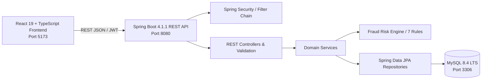

# TrustPay Guardian: Fraud-Aware Digital Banking Platform

[](https://www.oracle.com/java/)
[](https://spring.io/projects/spring-boot)
[](https://dev.mysql.com/downloads/)
[](https://react.dev/)
[](https://www.typescriptlang.org/)
[](LICENSE)

> [!IMPORTANT]
> **Educational Simulation Disclaimer:**  
> TrustPay Guardian is an educational, portfolio-grade digital banking simulation designed to showcase secure modern Java full-stack engineering and explainable fraud-risk management workflows.  
> **It is NOT a real bank, payment processor, or financial institution.** It does NOT connect to real bank accounts, move real money, process real credit cards/UPI, or collect sensitive personal identity documents (such as real Aadhaar, PAN, or CVVs). All account numbers, balances, transactions, and users are strictly synthetic.

---

## Architecture Overview

TrustPay Guardian is built as a **Modular Monolith**:
- **Backend:** Layered Spring Boot 4.1.1 REST API compiled on Java 25 LTS with Spring Data JPA, Spring Security, stateless JWT authentication, and automated Flyway schema migrations.
- **Frontend:** Responsive React 19 + TypeScript single-page application bundled with Vite, styled using Bootstrap 5.3 with persistent light/dark themes (`tpg-theme`).
- **Database:** Local MySQL 8.4 LTS relational database enforcing atomic ledger transactions, pessimistic row locking, and CHECK constraints.



---

## Repository Structure

```text
trustpay-guardian/
├── .github/workflows/ci.yml       # Automated GitHub Actions build pipeline
├── docs/                          # Architecture, threat model, API & setup docs
│   ├── TECH_STACK_AND_VERSION_POLICY.md
│   └── PLANNING_GATE_0.md
├── backend/                       # Spring Boot 4.1.1 + Java 25 REST backend
│   ├── pom.xml
│   ├── mvnw / mvnw.cmd
│   └── src/main/java/com/trustpay/guardian/
├── frontend/                      # React 19 + TypeScript + Vite frontend
│   ├── package.json
│   ├── vite.config.ts
│   └── src/
├── scripts/                       # Native execution & verification scripts
├── compose.yaml                   # Optional container compose definition
└── README.md
```

---

## Native Windows Quick Start

### 1. Prerequisites
- **Java JDK 25 LTS** (`java -version`, `javac -version`)
- **Apache Maven 3.9+** (`mvn -version`)
- **Node.js v24.15+ LTS & npm 11+** (`node -v`, `npm -v`)
- **MySQL Server 8.4 LTS** running on `localhost:3306`

### 2. Backend Execution
```powershell
cd backend
.\mvnw.cmd clean verify
.\mvnw.cmd spring-boot:run
```
The backend starts at `http://localhost:8080`.  
Health check endpoint: `http://localhost:8080/api/v1/health`

### 3. Frontend Execution
```powershell
cd frontend
npm install
npm run dev
```
The frontend starts at `http://localhost:5173`.

---

## Implementation Roadmap

- [x] **Phase 0:** Repository Inspection & Planning (Completed & Approved)
- [x] **Phase 1:** Repository Skeleton & Toolchain (Active)
- [ ] **Phase 2:** Database Schema & Flyway Migrations
- [ ] **Phase 3:** Shared Backend Foundation & Security Base
- [ ] **Phase 4:** Authentication & Authorization
- [ ] **Phase 5:** Accounts & Beneficiary Management
- [ ] **Phase 6:** Core Transfer Engine & Concurrency Safety
- [ ] **Phase 7:** Deterministic Fraud-Risk Engine (7 Rules)
- [ ] **Phase 8:** Fraud Analyst Workflow
- [ ] **Phase 9:** Admin Operations & Audit Logging
- [ ] **Phase 10:** Backend Observability & Hardening
- [ ] **Phase 11:** Frontend Shell, Theme & Landing Page
- [ ] **Phase 12:** Frontend Customer Experience
- [ ] **Phase 13:** Frontend Analyst & Admin Consoles
- [ ] **Phase 14:** Full-Stack Integration & Smoke Testing
- [ ] **Phase 15:** Docker Compose & CI Pipeline
- [ ] **Phase 16:** Final Documentation & Demonstration Walkthrough

---

## Documentation Links

- [Tech Stack & Version Policy](docs/TECH_STACK_AND_VERSION_POLICY.md)
- [Gate 0 Architectural Plan](docs/PLANNING_GATE_0.md)
- [PRD Specification](TrustPay_Guardian_PRD.md)
- [Security Policy](SECURITY.md)
- [Contributing Guidelines](CONTRIBUTING.md)
