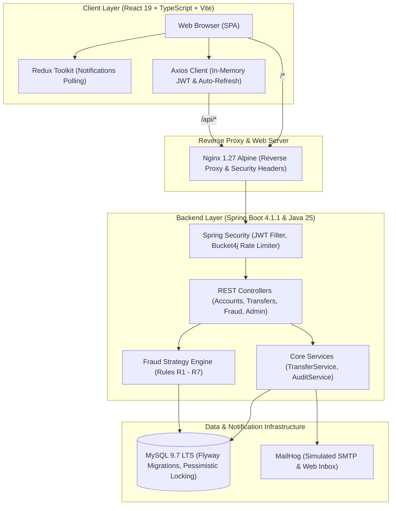

# TrustPay Guardian: Fraud-Aware Digital Banking Platform

[](https://www.oracle.com/java/)
[](https://spring.io/projects/spring-boot)
[](https://dev.mysql.com/downloads/)
[](https://react.dev/)
[](https://www.typescriptlang.org/)
[](https://www.docker.com/)
[](docs/verification/phase-08.md)
[](LICENSE)

> [!IMPORTANT]
> **Educational Simulation & Regulatory Disclaimer:**  
> TrustPay Guardian is an educational, portfolio-grade digital banking simulation designed to showcase secure modern Java full-stack engineering and explainable fraud-risk management workflows.  
> **It is NOT a real bank, payment processor, or financial institution, and is NOT certified against PCI-DSS, ISO 27001, RBI Digital Payment Security Controls, or any banking regulation.** It does NOT connect to real bank accounts, move real money, process real credit cards/UPI, or collect sensitive personal identity documents (such as real Aadhaar, PAN, or CVVs). All account numbers, balances, transactions, and users are strictly synthetic.

---

## 1. System Architecture Overview



---

## 2. Core Capabilities & Feature Highlights

- **Fraud Strategy Engine (100% Deterministic & Explainable):**
  - **R1 (High Amount):** Evaluates transfers exceeding ₹50,000 threshold (+35 points).
  - **R2 (Rapid Velocity):** Flags more than 3 transfers within a rolling 5-minute window (+25 points).
  - **R3 (New Beneficiary):** Detects first-time transfers to unverified accounts (+20 points).
  - **R4 (Dormant Account Awakening):** Flags transactions on accounts inactive for >60 days (+20 points).
  - **R5 (High Balance Depletion):** Flags single transfers draining >80% of account balance (+25 points).
  - **R6 (Round Figure Anomaly):** Flags round sums (multiples of ₹10,000 above ₹25,000) (+15 points).
  - **R7 (Recent Failed Logins):** Flags accounts with >=3 failed logins in the past 15 minutes (+20 points).
  - **Dynamic Score Bands:** `0–39` (Low Risk / Auto-Approved), `40–69` (Medium Risk / Pending Analyst Review), `70–100` (High Risk / Auto-Blocked).

- **Financial Integrity & Concurrency Controls:**
  - All monetary values are strictly represented as `BigDecimal` in Java and `DECIMAL(19,2)` in MySQL.
  - Ascending-ID row-level locking (`PessimisticWrite`) prevents deadlocks during bidirectional transfers.
  - Mandatory client UUID `Idempotency-Key` header with server-side caching prevents double debits.
  - Invariant balance checks: Available balance = Current Balance − Pending Holds (cannot overdraw).

- **Production-Grade Security Architecture:**
  - **In-Memory Access Tokens:** Zero persistence in `localStorage` or `sessionStorage` (XSS mitigation).
  - **Silent Token Rotation:** HttpOnly, SameSite=Strict refresh cookies with SHA-256 reuse-detection.
  - **Token Bucket Rate Limiting:** 10 login attempts/min/IP and 20 transfer attempts/min/user via Bucket4j.
  - **Role-Based Access Control (RBAC):** Strict boundaries across `CUSTOMER`, `FRAUD_ANALYST`, and `ADMIN`.

---

## 3. Technology Stack

| Layer | Technologies & Libraries |
|---|---|
| **Backend** | Java 25 (LTS), Spring Boot 4.1.1, Spring Data JPA, Spring Security 6, Flyway 10, Bucket4j 8, JaCoCo |
| **Frontend** | React 19.3, TypeScript 5.7, Vite 6, Bootstrap 5.3, Recharts, React Hook Form, Zod, Vitest |
| **Database** | MySQL Community Server 9.7 LTS / 8.4 LTS, HikariCP Connection Pool |
| **Testing** | JUnit 5, Mockito, AssertJ, MockMvc, Vitest, React Testing Library, Playwright |
| **DevOps** | Docker, Docker Compose, Nginx 1.27 Alpine, Jenkins, GitHub Actions, MailHog |

---

## 4. Quick Start (Single Command via Docker)

### Option A: Complete Containerized Stack
Clone the repository and launch the full system with a single command:
```bash
# Clone the repository
git clone https://github.com/surendrabeniwal85/TrustPay-Guardian.git
cd TrustPay-Guardian

# Start all services (MySQL, MailHog, Backend, and Frontend)
docker compose up --build
```
Once initialized, access the platform at:
- **Web Application:** `http://localhost` (or `http://localhost:3000`)
- **Backend REST API:** `http://localhost:8080/api/v1`
- **Swagger OpenAPI Documentation:** `http://localhost:8080/swagger-ui.html`
- **MailHog Simulated Inbox:** `http://localhost:8025`

### Option B: Local Developer Mode
If you prefer running services natively for development:

1. **Start Database & MailHog:**
   ```bash
   docker compose up -d mysql mailhog
   ```
2. **Start Spring Boot Backend:**
   ```bash
   cd backend
   ./mvnw spring-boot:run -Dspring-boot.run.profiles=dev
   # Windows: .\mvnw.cmd spring-boot:run -Dspring-boot.run.profiles=dev
   ```
3. **Start React Frontend:**
   ```bash
   cd frontend
   npm install
   npm run dev
   # Access UI at http://localhost:5173
   ```

---

## 5. Seed Demonstration Personas

*Synthetic credentials seeded automatically in development mode:*

| Role | Persona Name | Email | Password | Initial Account | Opening Balance |
|---|---|---|---|---|---|
| **CUSTOMER** | John Doe | `john.doe@trustpay.internal` | `Password123!` | `TPG1000000001` | ₹50,000.00 |
| **CUSTOMER** | Jane Smith | `jane.smith@trustpay.internal` | `Password123!` | `TPG1000000002` | ₹30,000.00 |
| **FRAUD_ANALYST** | Alex Vance | `analyst@trustpay.internal` | `Password123!` | *Staff Persona* | *N/A* |
| **ADMIN** | Sarah Connor | `admin@trustpay.internal` | `Password123!` | *Staff Persona* | *N/A* |

---

## 6. Verification & Test Commands

### Backend Verification
```bash
# Run unit and integration tests with JaCoCo verification (>= 80% line coverage gate)
cd backend
./mvnw clean verify
```

### Frontend Verification
```bash
# Typecheck and lint
cd frontend
npm run lint

# Run Vitest unit & component test suite
npm test -- --run

# Build production bundle
npm run build

# Run Playwright end-to-end smoke test
npx playwright test
```

---

## 7. Documentation Suite Sitemap

| Document | Purpose & Contents |
|---|---|
| [System Architecture](docs/ARCHITECTURE.md) | High-level component interactions, state machine, and fraud engine pipeline |
| [Requirements Traceability](docs/REQUIREMENTS_TRACEABILITY.md) | Bidirectional mapping of PRD specifications to code implementation and tests |
| [Database Schema Design](docs/DATABASE_DESIGN.md) | Entity relational model, indexes, balance check constraints, and Flyway migrations |
| [Security Review](docs/SECURITY_REVIEW.md) | OWASP Top 10 assessment, cryptographic controls, and token security analysis |
| [Decisions Log (ADR)](docs/DECISIONS.md) | Architectural Decision Records explaining key design trade-offs |
| [Interactive Demo Walkthrough](docs/DEMO_WALKTHROUGH.md) | Step-by-step guide to executing low-risk, held, and blocked transfer scenarios |
| [Phase Verification Records](docs/verification/) | Evidence-based audit logs for every development phase (Phases 00 to 14) |
| [Threat Model](docs/THREAT_MODEL.md) | STRIDE threat classification, attack vectors, and mitigations |
| [Runbook](docs/RUNBOOK.md) | Operational playbooks for production deployment, backups, and disaster recovery |

---

## 8. License & Authorship

Developed under the **MIT License**. Created by the TrustPay Guardian Engineering Team as a reference architecture for secure digital banking and explainable transaction risk management.
