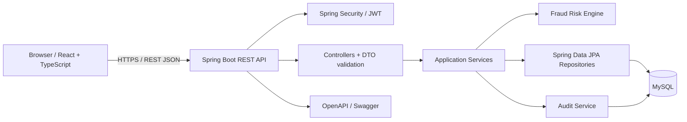

# Product Requirements Document (PRD)

## TrustPay Guardian: Fraud-Aware Digital Banking Platform

**Document type:** Product Requirements Document and implementation
specification\
**Project title:** TrustPay Guardian: Fraud-Aware Digital Banking
Platform\
**Primary database:** MySQL\
**Target architecture:** Java Full Stack web application\
**Intended audience:** Student developer, Antigravity coding agent,
reviewers, interviewers\
**Status:** Build specification --- implementation details must be
verified against the code as it is created

------------------------------------------------------------------------

## 1. Executive summary

TrustPay Guardian is an educational, portfolio-grade digital banking
simulation with fraud-aware transaction workflows. It demonstrates how a
secure banking-style web application can support customer accounts,
simulated transfers, transaction history, risk scoring, fraud alerts,
case review, administrative controls, and auditability.

The project must be presented as a **simulation and learning platform**,
not as a real bank, payment processor, or production financial service.
It must not connect to real bank accounts, move real money, or collect
real payment credentials. Use clearly labelled demo data and simulated
balances/transfers.

The core value is to combine a polished, interactive digital-banking
user experience with a layered Java backend, MySQL persistence,
role-based access control, transaction safety, test coverage, and an
explainable fraud-risk workflow.

## 2. Product vision and goals

### 2.1 Vision

Build a demonstrable full-stack platform where a user can explore a
simulated banking dashboard while an administrator or fraud analyst can
review suspicious activity using transparent risk indicators and
auditable decisions.

### 2.2 Primary goals

1.  Demonstrate Core Java and modern Java concepts in real application
    code where appropriate.
2.  Use Spring Boot to build a maintainable REST API.
3.  Use MySQL as the authoritative relational database.
4.  Build a responsive React + TypeScript frontend with meaningful
    loading, empty, error, and success states.
5.  Implement secure registration, login, JWT-based authentication, and
    role-based authorization.
6.  Implement simulated accounts, transfers, transaction history, and
    safe balance updates.
7.  Add a deterministic, explainable fraud-risk engine and a
    fraud-review workflow.
8.  Build separate customer, analyst, and administrator experiences.
9.  Add unit, integration, frontend, and end-to-end checks proportionate
    to the project.
10. Keep the code understandable through strong naming, documentation,
    diagrams, and a staged implementation process.
11. Make the project suitable for a university capstone demonstration
    and technical interview.

### 2.3 Non-goals

-   Real banking integrations, real funds movement, card processing, UPI
    processing, or payment gateway connectivity.
-   Real KYC, Aadhaar, PAN, government identity verification, or
    collection of sensitive identity documents.
-   Production-grade regulatory certification or a claim of compliance
    with PCI DSS, RBI requirements, or any financial regulation.
-   A claim that the fraud engine is a trained, production-validated
    machine-learning model.
-   Microservices as a default implementation. Start with a modular
    monolith; explain where services could be separated in a future
    design.
-   Collecting real customer financial information.
-   Storing CVV, card PINs, banking passwords, or raw secrets.

## 3. Users and roles

### 3.1 Guest

-   View the public home page, feature overview, safety disclaimer, and
    project explainer media.
-   Open registration and login pages.
-   Cannot see private accounts, transactions, or admin pages.

### 3.2 Customer

-   Register and sign in.
-   View own profile and simulated account(s).
-   View own available simulated balance and transaction history.
-   Initiate a simulated transfer to a demo beneficiary or another
    eligible demo account.
-   See transfer status and any fraud warning or hold.
-   View own notifications and transaction details.
-   Update permitted profile fields and sign out.
-   Must never access another customer's private data by changing a URL
    or API identifier.

### 3.3 Fraud Analyst

-   Access a protected fraud-operations dashboard.
-   View fraud alerts and flagged transactions permitted by policy.
-   Inspect the risk score, risk factors, event history, and related
    simulated transaction metadata.
-   Record a case decision such as `CONFIRMED_FRAUD`, `FALSE_POSITIVE`,
    or `NEEDS_REVIEW`, with a required reason.
-   Cannot manage system administrators or change security configuration
    unless explicitly granted an additional permission.

### 3.4 Administrator

-   Access a protected administration dashboard.
-   Manage demo users: view, activate/deactivate, and assign approved
    roles according to least privilege.
-   View aggregate system metrics, transaction summaries, audit events,
    and fraud queue summaries.
-   Manage safe demo configuration, such as transfer limits and
    risk-rule thresholds, only if implemented with validation and audit
    logging.
-   Cannot view plaintext passwords, JWTs, secrets, or unnecessary
    sensitive data.
-   All sensitive administrative actions must be logged.

### 3.5 Role and permission policy

Minimum roles: `CUSTOMER`, `FRAUD_ANALYST`, `ADMIN`. Optional `AUDITOR`
role may be added only if the implementation can enforce read-only
access clearly.

Enforce authorization on the backend. Hiding frontend menu items is only
a user-experience measure and never a security boundary. Default new
registrations to `CUSTOMER`; public registration must never allow a
caller to choose `ADMIN` or `FRAUD_ANALYST`.

## 4. Core user journeys

### Journey A --- Public visitor

1.  Open home page.
2.  See project purpose, feature cards, animated but accessible visual
    elements, and a short relevant video or local demo animation.
3.  Review the simulation disclaimer.
4.  Navigate to registration or login.

### Journey B --- Register and log in

1.  Submit name, email, and password.
2.  Frontend performs basic usability validation.
3.  Backend validates and normalizes input.
4.  Backend checks email uniqueness and hashes the password with a
    suitable password encoder.
5.  Create the account with the default `CUSTOMER` role.
6.  Login validates credentials and returns a short-lived access token,
    plus a refresh-token design only if implemented safely.
7.  Frontend handles token lifecycle according to the documented
    security decision.
8.  Protected routes and backend endpoints enforce authentication and
    roles.
9.  Show useful, non-sensitive error messages for invalid credentials or
    duplicate email.

### Journey C --- Customer dashboard

1.  Customer signs in.
2.  Dashboard loads own profile, account summary, recent transactions,
    and notifications through APIs.
3.  Show loading skeletons, empty states, and recoverable error states.
4.  Customer can filter transaction history by date, status, type, and
    amount where supported.
5.  All server queries must be scoped to the authenticated user.

### Journey D --- Simulated transfer

1.  Customer chooses a source demo account, recipient/beneficiary,
    amount, and optional note.
2.  Frontend validates required fields and reasonable amount formatting.
3.  Backend validates request, identity, account ownership, account
    status, positive amount, configured limits, recipient eligibility,
    and available balance.
4.  Risk engine evaluates the transaction using deterministic,
    documented rules.
5.  Within a database transaction, the system applies a safe decision:
    -   Low risk: simulate transfer and record the transaction.
    -   Medium risk: mark for review or require an additional
        confirmation step if implemented.
    -   High risk: place the simulated transfer on hold or reject it
        according to documented rules.
6.  Balance debits and credits, ledger/transaction records, alert
    records, and audit events must be consistent and atomic when the
    transfer is approved.
7.  Use database locking or optimistic/pessimistic concurrency control
    to prevent simultaneous requests from overspending a demo balance.
8.  Return a clear status and reference ID.
9.  Show the result in the UI without claiming that real money moved.

### Journey E --- Fraud review

1.  Analyst opens the fraud queue.
2.  Queue supports pagination, filtering, sorting, and clear status
    labels.
3.  Analyst opens a case and sees the transaction summary, score, reason
    codes, and relevant history permitted by policy.
4.  Analyst records a decision and mandatory notes/reason.
5.  Backend validates analyst permission and case state.
6.  System stores decision, reviewer, timestamp, and audit event.
7.  Queue and dashboard update to reflect the new state.

### Journey F --- Admin operations

1.  Admin signs in.
2.  Admin dashboard shows safe aggregate metrics and pending alerts.
3.  Admin searches and filters users.
4.  Admin can deactivate/reactivate a demo account or update allowed
    role assignments.
5.  The backend prevents self-escalation and unauthorized role changes.
6.  Every sensitive change creates an audit event.
7.  All actions return explicit success/failure feedback.

## 5. Functional requirements

Use stable IDs for requirements so they can be tracked in issues and
tests.

### 5.1 Public experience

-   `PUB-01`: Provide a responsive public home page with the exact
    project title.
-   `PUB-02`: Include clear sections for features, how it works,
    fraud-awareness approach, technology stack, and demo disclaimer.
-   `PUB-03`: Include relevant project video content on the home page.
    Prefer a locally stored, licensed/owned MP4 or an original
    lightweight animation; if external video is used, provide a graceful
    fallback and do not autoplay sound.
-   `PUB-04`: Provide visible Login and Register calls to action.
-   `PUB-05`: Provide dark and light themes, a user-controlled toggle,
    and persisted preference.
-   `PUB-06`: Ensure reduced-motion preference, keyboard navigation,
    sufficient contrast, captions or text alternative for video, and
    responsive layouts.
-   `PUB-07`: Do not use copyrighted banking logos, real customer data,
    or misleading claims.

### 5.2 Authentication and identity

-   `AUTH-01`: Register using validated name, email, and password.
-   `AUTH-02`: Hash passwords with a modern password encoder; never
    store plaintext or reversibly encrypted passwords.
-   `AUTH-03`: Login returns a documented authentication response.
-   `AUTH-04`: Enforce role-based access in Spring Security.
-   `AUTH-05`: Public registration assigns only `CUSTOMER`.
-   `AUTH-06`: Provide logout and token expiry handling.
-   `AUTH-07`: Protect against brute-force attempts with a simple,
    documented rate-limit/lockout strategy appropriate for a local demo.
-   `AUTH-08`: Return safe authentication errors without leaking whether
    an email exists unnecessarily.
-   `AUTH-09`: Validate account active status during login and on
    relevant requests.
-   `AUTH-10`: Never log credentials, tokens, password hashes, or
    secrets.
-   `AUTH-11`: If refresh tokens are implemented, store only a secure
    hash or use an equally defensible revocation design; rotate and
    revoke them. Do not add refresh-token complexity without tests and
    documentation.
-   `AUTH-12`: Document token storage trade-offs. Prefer secure,
    HttpOnly cookies when the implementation can handle CSRF protection
    correctly; if using browser storage for a student demo, document the
    XSS risk and never describe it as the strongest production approach.

### 5.3 Customer and accounts

-   `CUST-01`: Customers can view and update only approved fields in
    their own profile.
-   `ACCT-01`: Each customer has one or more simulated accounts, with
    currency fixed to INR for the initial release.
-   `ACCT-02`: Display masked demo account identifiers; never present
    the demo account as a real bank account.
-   `ACCT-03`: Account status is explicit, e.g. `ACTIVE`, `FROZEN`,
    `CLOSED`.
-   `ACCT-04`: Customers can only access their own accounts.
-   `ACCT-05`: Seed data must be obviously synthetic and must not
    resemble real credentials.

### 5.4 Transfers and transaction history

-   `TXN-01`: Support simulated transfers between eligible demo
    accounts.
-   `TXN-02`: Reject zero, negative, malformed, or out-of-policy
    transfer amounts.
-   `TXN-03`: Check source account ownership and status, recipient
    validity, and available balance on the backend.
-   `TXN-04`: Use database transactions for approved balance-changing
    operations.
-   `TXN-05`: Use concurrency protection against double-spend/race
    conditions.
-   `TXN-06`: Assign a unique transaction reference and timestamps.
-   `TXN-07`: Store statuses such as `PENDING_REVIEW`,
    `APPROVED_SIMULATED`, `REJECTED`, `ON_HOLD`, `CANCELLED` only where
    transitions are defined.
-   `TXN-08`: Display transaction history with pagination and filters.
-   `TXN-09`: Never allow customers to alter transaction status or
    balances directly through request fields.
-   `TXN-10`: Provide idempotency protection for transfer submission so
    retrying a request does not create duplicate transfers.
-   `TXN-11`: Keep a ledger-style record or otherwise demonstrate a
    traceable and consistent balance movement model. Document the chosen
    model.
-   `TXN-12`: Clearly label the UI and receipts as simulated
    transactions.

### 5.5 Fraud-risk engine

-   `FRAUD-01`: Implement an explainable, deterministic rule-based risk
    engine for the first release.
-   `FRAUD-02`: Return a numeric risk score in a documented range
    (recommended 0--100), a risk level, and human-readable reason codes.
-   `FRAUD-03`: Use configurable, documented demo rules such as
    unusually large amount relative to configured limits, rapid repeated
    transfers, repeated failed attempts, or a recipient/account flagged
    in synthetic seed data.
-   `FRAUD-04`: Rules must be transparent, testable, and not claim to be
    a trained ML model.
-   `FRAUD-05`: Define risk bands in configuration or a single
    well-named policy class, not scattered magic numbers.
-   `FRAUD-06`: The risk decision must be integrated with transfer
    processing and produce a fraud alert/case when policy requires it.
-   `FRAUD-07`: Store risk score, rule identifiers, decision, and
    timestamp for audit and reproducibility.
-   `FRAUD-08`: Do not use protected personal characteristics or infer
    sensitive traits in risk scoring.
-   `FRAUD-09`: Include unit tests for each rule, score boundary, and
    combined-rule behaviour.
-   `FRAUD-10`: Keep a future extension point for an ML model, but do
    not add an unvalidated model to the initial critical transfer path.

### 5.6 Fraud operations

-   `CASE-01`: Analysts can view only the cases allowed by their role.
-   `CASE-02`: Support case statuses such as `OPEN`, `IN_REVIEW`,
    `RESOLVED`, `FALSE_POSITIVE`.
-   `CASE-03`: Require a reason/comment for decisions.
-   `CASE-04`: Record reviewer identity and timestamps.
-   `CASE-05`: Prevent invalid state transitions and duplicate
    resolution actions.
-   `CASE-06`: Provide filters, sorting, pagination, and case detail
    view.
-   `CASE-07`: All review actions create immutable-style audit records;
    do not expose an endpoint to edit/delete audit history.

### 5.7 Administration and audit

-   `ADMIN-01`: Admin dashboard includes user counts, simulated
    transaction totals, pending fraud cases, and recent audit events.
-   `ADMIN-02`: Admin user management supports search, pagination,
    status changes, and permitted role assignments.
-   `ADMIN-03`: Backend authorization must reject unauthorized admin
    requests even when called directly.
-   `ADMIN-04`: Prevent a non-admin from assigning roles or changing
    account status.
-   `ADMIN-05`: Prevent unsafe self-role escalation and accidental
    removal of the final active administrator.
-   `ADMIN-06`: Log administrative and fraud decisions with actor,
    action, target, timestamp, and safe metadata.
-   `ADMIN-07`: Do not log secrets or unnecessary personal data.
-   `ADMIN-08`: Destructive actions should be disabled by default in the
    demo; prefer soft deactivation over deleting users or transaction
    history.

### 5.8 User interface and dashboard

-   `UI-01`: Responsive layouts for desktop, tablet, and mobile.
-   `UI-02`: Consistent visual system with accessible contrast,
    typography, spacing, and status colours.
-   `UI-03`: Customer, analyst, and admin dashboards must show
    role-appropriate navigation and data.
-   `UI-04`: Provide loading, empty, error, retry, success, and
    permission-denied states.
-   `UI-05`: Use chart components only for meaningful data; label
    simulated/demo data clearly.
-   `UI-06`: Theme selection should persist without flashing the wrong
    theme where reasonably possible.
-   `UI-07`: Avoid fake live metrics. Use seeded/demo data with a clear
    label or real API results.
-   `UI-08`: Use a consistent toast/notification strategy and
    confirmation dialogs for consequential demo actions.
-   `UI-09`: Include accessible labels, form error text, keyboard focus
    states, and semantic markup.
-   `UI-10`: The home-page video must not block page load; lazy-load
    where possible, provide poster/fallback, and respect reduced motion.

### 5.9 Observability and operations

-   `OPS-01`: Use SLF4J + Logback through standard Spring Boot logging.
-   `OPS-02`: Use structured, contextual logs without secrets,
    passwords, tokens, or unnecessary PII.
-   `OPS-03`: Use Spring Boot Actuator only for safe health/diagnostic
    endpoints; restrict sensitive endpoints.
-   `OPS-04`: Provide meaningful health checks and startup diagnostics.
-   `OPS-05`: Use a consistent error response format and
    correlation/request ID where practical.
-   `OPS-06`: Document log levels and how to diagnose common failures.

## 6. Non-functional requirements

### Security

-   Backend is the source of truth for identity, roles, ownership,
    balances, risk decisions, and transaction status.
-   Use parameterized ORM/repository queries; avoid SQL string
    concatenation with user input.
-   Validate all input at the API boundary and re-check business
    invariants in the service layer.
-   Use least privilege, safe CORS configuration, secure headers, and
    appropriate CSRF handling based on the authentication mechanism.
-   Use BCrypt or another Spring Security-supported adaptive password
    hash.
-   Keep secrets out of source control and Git history.
-   Use synthetic seed data and redact logs.
-   Provide an OWASP Top 10 review checklist.
-   Clearly state that the project is educational and not
    production-certified.

### Reliability and consistency

-   Approved transfer updates must be atomic.
-   Database constraints must reinforce important invariants where
    possible.
-   Handle duplicate submissions and concurrency safely.
-   Errors must not leave half-completed transfers.
-   Database migration scripts should be versioned; do not rely on
    Hibernate `ddl-auto=update` as the production schema-management
    strategy.
-   Provide predictable startup and local development instructions.

### Maintainability

-   Use layered architecture and meaningful names.
-   Keep controllers thin; place business logic in services and risk
    rules in dedicated components.
-   Use DTOs rather than exposing persistence entities directly through
    APIs.
-   Avoid duplicated business rules and magic values.
-   Add tests around business-critical rules.
-   Document architectural decisions and trade-offs.

### Performance

-   Paginate potentially large lists.
-   Add indexes for frequent lookups and relationships based on query
    needs.
-   Avoid N+1 query problems where applicable.
-   Set sensible request sizes and validation limits.
-   Performance targets are demo targets, not financial-service SLAs;
    document any unmeasured claims.

### Accessibility and usability

-   Aim for WCAG 2.1 AA-oriented practices: semantic controls, keyboard
    operation, focus visibility, sufficient contrast, and alternatives
    for non-text content.
-   Do not communicate status by colour alone.
-   Honour reduced-motion preferences.
-   Ensure readable mobile layouts.

## 7. Recommended technology stack

The attached Java Full Stack syllabus is the primary curriculum
reference. The following maps directly to its modules.

### 7.1 Frontend

-   HTML5 and CSS3.
-   Bootstrap 5 for responsive layout and utility classes.
-   JavaScript ES6+ and TypeScript.
-   React with functional components and hooks.
-   React Router v6 for routing and protected routes.
-   Context API for theme/auth state initially; Redux Toolkit only if
    state complexity justifies it.
-   Axios or Fetch for API calls; choose one primary client and use it
    consistently.
-   React Hook Form with Zod or Yup for forms and validation.
-   Recharts or another small, documented chart library for dashboards,
    if useful.
-   Jest and React Testing Library; Playwright for a small number of
    end-to-end smoke tests.
-   Use Vite for frontend development/build tooling.

### 7.2 Backend

-   **Java 25 LTS (JDK 25)** is the required language/runtime baseline.
    Use the latest available security patch within the Java 25 line at
    implementation time. As checked on 2026-10-17, Oracle lists JDK
    25.0.4.1; re-check the official JDK 25 release notes before installation.
    Set the Maven compiler `release` to `25` and configure IDE, terminal,
    CI and deployment to use the same Java major version.
-   **Spring Boot 4.1.x**, using the latest stable GA patch available when
    implementation begins (not a milestone, release candidate or snapshot).
    As checked on 2026-10-17, Spring Boot 4.1.1 is listed as stable and
    supports Java 25. Verify compatibility of every selected dependency
    against the exact Spring Boot patch before adding it.
-   If a required third-party library is not yet compatible with Spring Boot
    4.x, do not silently downgrade or mix generations. Report the blocker
    and propose a verified alternative before proceeding.
-   Spring Web / REST controllers.
-   Spring Validation.
-   Spring Data JPA and Hibernate.
-   Spring Security.
-   JWT library compatible with the selected Spring Boot version.
-   Maven.
-   Spring Boot Actuator for carefully restricted health endpoints.
-   SLF4J + Logback.
-   springdoc-openapi / OpenAPI 3 and Swagger UI.
-   Lombok is optional; prefer explicit code if it makes learning and
    debugging easier.
-   MapStruct is optional; simple explicit mapping is acceptable for a
    student project.

### 7.3 Database

-   **MySQL 9.7 LTS** as the preferred database baseline, using the latest
    compatible maintenance patch available at implementation time. As checked
    on 2026-10-17, MySQL announced the 9.7 LTS line. If a school/lab environment
    only provides MySQL 8.4 LTS, document the reason and test against that
    exact version rather than mixing unsupported assumptions.
-   Use a matching, current MySQL Connector/J release supported by the chosen
    Spring Boot dependency management; do not override managed versions without
    a documented compatibility/security reason.
-   MySQL Connector/J.
-   Flyway for versioned migrations.
-   MySQL Workbench or command-line client for inspection.
-   Use `DECIMAL` for money-like simulated amounts, never floating-point
    `FLOAT`/`DOUBLE` for stored monetary values.
-   Use `BigDecimal` in Java for monetary arithmetic.
-   Keep currency explicit; initial release uses INR only.
-   Use a separate development/test database and never run test cleanup
    against personal or production data.

### 7.4 Testing and quality

-   JUnit 5.
-   Mockito.
-   Spring Boot Test.
-   MockMvc.
-   Testcontainers for MySQL integration tests where Docker is
    available; if not, provide a clearly documented local-MySQL test
    profile.
-   JaCoCo for coverage reports.
-   SonarQube/SonarLint awareness; optional local scan if environment
    allows.
-   ESLint and Prettier for frontend code.
-   React Testing Library and Playwright smoke tests.

### 7.5 Version policy and frontend/runtime tooling

-   React: use the latest stable React 19.x release available at implementation
    time; the official React version page listed React 19.3 on 2026-10-17.
-   TypeScript, Vite, React Router, Axios (or Fetch), React Hook Form, Zod,
    Bootstrap 5, ESLint, Prettier and testing libraries: use current stable
    mutually compatible versions, pinned in `package.json` and the lockfile.
    Do not use beta, canary or nightly releases.
-   Node.js: use the latest supported LTS release compatible with the selected
    Vite/tooling versions; pin the major in `.nvmrc` (or `.node-version`) and
    `package.json` `engines`, and document the exact patch used.
-   Maven: use the latest stable GA Maven 3.x release for the simplest
    educational setup; Apache Maven 3.10.0 was listed as GA on 2026-10-17.
    Do not use Maven 4 release candidates. Record `mvn -version` in setup docs.
-   Docker and GitHub Actions: use maintained stable versions/actions, pin
    third-party actions to full commit SHAs where practical, and avoid floating
    `latest` tags for production deployment images.
-   **Version verification rule:** immediately before generating the project,
    verify versions from official vendor release pages. Record the date checked,
    selected exact versions, official source URLs, and any compatibility notes
    in `docs/TECH_STACK_AND_VERSION_POLICY.md`. Pin exact dependency versions
    through Spring Boot's dependency management and the frontend lockfile.
    Prefer the newest stable, supported versions—not simply the newest preview.

### 7.6 Delivery and tooling

-   Git and GitHub.
-   `.gitignore`, branch/commit conventions, pull request template and
    issue templates.
-   GitHub Actions for build, test, and static checks.
-   Docker and Docker Compose for local app/database startup, optional
    but recommended after local setup works.
-   Jenkins concepts may be documented, as in the syllabus; do not build
    two competing CI pipelines without need.
-   Kubernetes is awareness-only for the initial release; do not deploy
    to Kubernetes unless specifically required.
-   Cloud provider deployment is optional and must never be a
    prerequisite for local demo.

### 7.6 Advanced project additions beyond the syllabus

These features add complexity beyond the curriculum and should be
implemented only after the core stack is working: 1. Fraud-risk policy
engine with reason codes. 2. Transaction idempotency and concurrency
safety. 3. Audit trail for privileged actions. 4. Role/permission matrix
and account ownership checks. 5. Versioned database migrations. 6.
Optional outbox/event abstraction for future notifications; avoid
unnecessary Kafka or complex messaging in v1. 7. Optional anomaly
analytics based on synthetic data, separate from the core deterministic
rules. 8. Optional service boundary diagrams and a future microservices
evolution note. 9. Docker Compose and CI checks. 10. Threat model and
abuse-case testing.

## 8. Architecture and module boundaries

Use a **modular monolith** for version 1. One Spring Boot application,
one MySQL database, clear package boundaries. This is easier to
understand, run, test, and demonstrate than a premature microservices
architecture.

### 8.1 High-level architecture



### 8.2 Backend package responsibilities

-   `config`: CORS, security, OpenAPI, properties, and other
    configuration.
-   `security`: JWT parsing/creation, filters, user details, and
    security-specific helpers.
-   `auth`: registration, login, token handling, authentication DTOs.
-   `user`: user/profile administration and role assignment rules.
-   `account`: simulated bank accounts and account ownership.
-   `transaction`: transfer requests, transaction history,
    ledger/balance operations, status transitions.
-   `fraud`: risk scoring, rules, alerts, case review.
-   `audit`: append-only-style audit records and audit queries.
-   `notification`: in-app notifications, if implemented.
-   `dashboard`: aggregated dashboard responses.
-   `common`: shared error response, exceptions, constants, and utility
    types. Do not turn this into a dumping ground.
-   `health` or Actuator configuration: operational checks.

Within feature packages, use `controller`, `service`, `repository`,
`entity`, and `dto` subpackages where it improves clarity. Do not create
empty layers just to follow a template.

### 8.3 Frontend module responsibilities

-   `app`: app setup, router, and providers.
-   `components`: shared UI components.
-   `layouts`: public, customer, analyst, and admin layouts.
-   `features/auth`: login, registration, auth forms and state.
-   `features/dashboard`: role-specific dashboard screens.
-   `features/accounts`: account summary and details.
-   `features/transactions`: transfer form, history, detail and filters.
-   `features/fraud`: analyst queue, case details, decision forms.
-   `features/admin`: users, roles, audit events and system metrics.
-   `features/settings`: theme and profile preferences.
-   `services/api`: API client and interceptors.
-   `hooks`: reusable hooks.
-   `types`: TypeScript interfaces and API contracts.
-   `utils`: formatting, validation helpers and safe reusable utilities.
-   `styles`: global styles and theme tokens.
-   `assets`: licensed/local media and images.

## 9. Suggested repository structure

The agent must adapt the structure to the actual files and avoid
creating duplicate or unused scaffolding.

``` text
trustpay-guardian/
├── README.md
├── LICENSE
├── .gitignore
├── .editorconfig
├── .gitattributes
├── CONTRIBUTING.md
├── SECURITY.md
├── CODE_OF_CONDUCT.md
├── CHANGELOG.md
├── .env.example
├── compose.yaml
├── docs/
│   ├── PROJECT_OVERVIEW.md
│   ├── PROJECT_STRUCTURE.md
│   ├── ARCHITECTURE.md
│   ├── DEVELOPMENT_WORKFLOW.md
│   ├── BACKEND_CODE_WALKTHROUGH.md
│   ├── API_DOCUMENTATION.md
│   ├── DATABASE_DESIGN.md
│   ├── FRONTEND_BACKEND_FLOW.md
│   ├── SECURITY_AND_CONFIGURATION.md
│   ├── TESTING_AND_DEBUGGING.md
│   ├── DEPLOYMENT_GUIDE.md
│   ├── LEARNING_AND_INTERVIEW_GUIDE.md
│   ├── GLOSSARY.md
│   ├── KNOWN_ISSUES_AND_IMPROVEMENTS.md
│   ├── REQUIREMENTS_TRACEABILITY.md
│   ├── THREAT_MODEL.md
│   └── decisions/
│       ├── ADR-001-modular-monolith.md
│       ├── ADR-002-authentication-storage.md
│       ├── ADR-003-fraud-rule-engine.md
│       └── ADR-004-money-and-ledger-model.md
├── frontend/
│   ├── package.json
│   ├── package-lock.json
│   ├── index.html
│   ├── vite.config.ts
│   ├── tsconfig.json
│   ├── tsconfig.app.json
│   ├── eslint.config.js
│   ├── .env.example
│   ├── public/
│   │   ├── media/
│   │   │   ├── trustpay-guardian-demo.mp4
│   │   │   └── trustpay-guardian-poster.webp
│   │   └── favicon.svg
│   └── src/
│       ├── main.tsx
│       ├── app/
│       │   ├── App.tsx
│       │   ├── router.tsx
│       │   └── providers.tsx
│       ├── components/
│       ├── layouts/
│       ├── features/
│       │   ├── auth/
│       │   ├── dashboard/
│       │   ├── accounts/
│       │   ├── transactions/
│       │   ├── fraud/
│       │   ├── admin/
│       │   └── settings/
│       ├── services/
│       │   └── api/
│       ├── hooks/
│       ├── types/
│       ├── utils/
│       ├── styles/
│       └── test/
├── backend/
│   ├── pom.xml
│   ├── mvnw
│   ├── mvnw.cmd
│   ├── .mvn/
│   ├── src/
│   │   ├── main/
│   │   │   ├── java/com/trustpayguardian/
│   │   │   │   ├── TrustPayGuardianApplication.java
│   │   │   │   ├── config/
│   │   │   │   ├── security/
│   │   │   │   ├── auth/
│   │   │   │   ├── user/
│   │   │   │   ├── account/
│   │   │   │   ├── transaction/
│   │   │   │   ├── fraud/
│   │   │   │   ├── audit/
│   │   │   │   ├── notification/
│   │   │   │   ├── dashboard/
│   │   │   │   └── common/
│   │   │   └── resources/
│   │   │       ├── application.yml
│   │   │       ├── application-dev.yml
│   │   │       ├── application-test.yml
│   │   │       └── db/migration/
│   │   │           ├── V1__create_identity_tables.sql
│   │   │           ├── V2__create_accounts.sql
│   │   │           ├── V3__create_transactions_and_ledger.sql
│   │   │           ├── V4__create_fraud_cases.sql
│   │   │           └── V5__create_audit_and_notifications.sql
│   │   └── test/
│   │       └── java/com/trustpayguardian/
│   └── target/                 # generated; do not commit
├── infra/
│   ├── Dockerfile.backend
│   ├── Dockerfile.frontend
│   └── mysql/
│       └── README.md
├── .github/
│   ├── workflows/
│   │   └── ci.yml
│   ├── ISSUE_TEMPLATE/
│   │   ├── bug_report.yml
│   │   └── feature_request.yml
│   └── pull_request_template.md
└── scripts/
    ├── dev-start.ps1
    ├── dev-start.sh
    └── verify-project.ps1
```

**Structure rules:** - Keep generated `target/`, `node_modules/`, build
outputs, logs, `.env` files and IDE-specific noise out of Git. - Commit
Maven wrapper scripts and wrapper files when generated correctly. -
Commit a lockfile for the chosen frontend package manager. - Avoid
duplicate backend/frontend configuration and duplicate docs. - Do not
create empty files for every proposed path; add only useful files. - The
package name can be `com.trustpayguardian`; document any chosen
variation consistently. - Keep SQL migrations as the schema source of
truth after the initial setup.

## 10. Data model proposal

This is a proposed model. The implementation must validate relationships
and refine it before coding.

### 10.1 Core tables

1.  `users`: id, full_name, email (unique), password_hash, status,
    created_at, updated_at, last_login_at.
2.  `roles`: id, name (unique), description.
3.  `user_roles`: user_id, role_id; unique composite key.
4.  `accounts`: id, user_id, masked_account_number or safe demo
    identifier, account_type, currency, balance, status, created_at.
5.  `beneficiaries` (optional): id, owner_user_id, recipient_account_id,
    display_name, status, created_at.
6.  `transactions`: id, reference, idempotency_key, source_account_id,
    destination_account_id, amount, currency, type, status, risk_score,
    created_at, completed_at.
7.  `ledger_entries`: id, transaction_id, account_id, entry_type,
    amount, currency, created_at. If used, enforce a clear
    balanced-entry model and document how balance is derived/reconciled.
8.  `fraud_cases`: id, transaction_id, risk_score, risk_level, status,
    assigned_to_user_id, decision, decision_reason, created_at,
    updated_at, resolved_at.
9.  `fraud_rule_hits`: id, fraud_case_id or transaction_id, rule_code,
    score_contribution, explanation, created_at.
10. `audit_events`: id, actor_user_id nullable for system events,
    action, target_type, target_id, safe_metadata_json, request_id,
    created_at.
11. `notifications`: id, user_id, type, title, message, read_at,
    created_at.
12. `refresh_tokens` (only if refresh tokens are implemented): id,
    user_id, token_hash, expires_at, revoked_at, created_at.

### 10.2 Data rules

-   Use `BIGINT` or UUID consistently for identifiers; explain the
    choice.
-   Use `DECIMAL(19,2)` or a justified precision for amounts and
    `BigDecimal` in Java.
-   Use UTC timestamps in storage and convert to local display time in
    the UI.
-   Use foreign keys, uniqueness constraints, and indexes where
    appropriate.
-   Do not store redundant balances and ledger data without a
    reconciliation rule.
-   Store only synthetic demo information.
-   Avoid soft deletion of financial/audit records where it would
    obscure history; use account status and retention policies instead.
-   Define referential actions deliberately; do not cascade-delete
    transaction or audit history accidentally.

## 11. API design proposal

Use a consistent prefix such as `/api/v1`. The exact API contract must
be written in OpenAPI and tested.

### Authentication

-   `POST /api/v1/auth/register`
-   `POST /api/v1/auth/login`
-   `POST /api/v1/auth/logout`
-   `POST /api/v1/auth/refresh` only if refresh tokens are implemented
-   `GET /api/v1/auth/me`

### Customer/profile

-   `GET /api/v1/users/me`
-   `PATCH /api/v1/users/me`

### Accounts

-   `GET /api/v1/accounts`
-   `GET /api/v1/accounts/{accountId}`
-   `GET /api/v1/accounts/{accountId}/transactions`

### Transfers and transactions

-   `POST /api/v1/transfers`
-   `GET /api/v1/transactions`
-   `GET /api/v1/transactions/{transactionId}`
-   `GET /api/v1/transfers/{reference}`

### Fraud operations

-   `GET /api/v1/fraud/cases`
-   `GET /api/v1/fraud/cases/{caseId}`
-   `PATCH /api/v1/fraud/cases/{caseId}/assignment` if assignment is
    supported
-   `POST /api/v1/fraud/cases/{caseId}/decision`

### Administration

-   `GET /api/v1/admin/dashboard`
-   `GET /api/v1/admin/users`
-   `PATCH /api/v1/admin/users/{userId}/status`
-   `PATCH /api/v1/admin/users/{userId}/roles`
-   `GET /api/v1/admin/audit-events`
-   `GET /api/v1/admin/settings` and `PATCH` only if configurable
    settings are implemented

### Health

-   `GET /actuator/health` with safe exposure and configuration.

Do not expose internal exception traces in API responses. Use consistent
response/error objects, validation messages, HTTP status codes,
pagination metadata, and API documentation. These are proposed routes,
not proof that routes already exist.

## 12. Fraud engine specification

### 12.1 Initial deterministic rules

Use a dedicated interface such as `FraudRule` and a `FraudRiskService`
or equivalent. Keep it understandable; avoid unnecessary plugin
frameworks.

Potential rules: - `AMOUNT_ABOVE_DEMO_LIMIT`: amount exceeds configured
demo threshold. - `RAPID_REPEAT_TRANSFERS`: several transfers from an
account within a configured time window. - `RECIPIENT_FLAGGED`:
recipient is marked as suspicious in synthetic seed data. -
`RECENT_FAILED_ATTEMPTS`: repeated failed transfer attempts within a
configured window. - `UNUSUAL_ACCOUNT_ACTIVITY`: a simple baseline
deviation using synthetic account history, if implementable and
testable.

Each rule returns a stable rule code, contribution, and explanation.
Score contributions are bounded and the final score is clamped to
0--100. Avoid hard-coded unexplained numbers.

### 12.2 Illustrative risk bands

-   0--29: LOW
-   30--59: MEDIUM
-   60--100: HIGH

These are initial demo policy values, not empirically validated
thresholds. Put them in typed configuration and cover boundaries with
tests.

### 12.3 Decision policy

-   LOW: eligible for simulated approval if all ordinary transfer checks
    pass.
-   MEDIUM: mark `PENDING_REVIEW` or request confirmation according to
    the selected policy.
-   HIGH: `ON_HOLD` or `REJECTED` and create a fraud case.
-   The final behaviour must be deterministic and documented.
-   Do not silently debit balances for a transfer held for review.
-   If a case is later cleared, process it through a defined,
    transactional state transition; do not replay an untrusted client
    request.

## 13. User experience and visual design

### 13.1 Visual direction

Create a modern, trustworthy fintech-inspired interface without
impersonating a real bank. Use a restrained palette, clear typography,
subtle gradients, readable data cards, tasteful motion, and consistent
spacing. Avoid excessive animation, fake stock tickers, or misleading
"real-time" indicators.

### 13.2 Home page sections

1.  Navigation bar with logo/wordmark, feature links, theme toggle,
    Login, Register.
2.  Hero section with exact title and concise project explanation.
3.  Main call-to-action to explore the demo or create a demo account.
4.  Project video/animation with poster, captions or text summary, no
    autoplay sound.
5.  Feature cards: simulated banking, fraud-aware transfers, risk
    explanation, secure role-based dashboards, auditability.
6.  "How it works" flow.
7.  Example risk review with synthetic data.
8.  Technology stack.
9.  Security and simulation disclaimer.
10. Footer with docs/GitHub link, project authorship placeholder, and
    educational disclaimer.

### 13.3 Dashboard pages

Customer: - Overview cards: simulated balance, recent activity, pending
review count if relevant. - Recent transactions. - Transfer action. -
Account list and transaction history. - Notifications and profile
settings.

Fraud analyst: - Queue summary and risk distribution. - Filterable fraud
case table. - Case details with score, rule hits, timeline, and decision
controls. - Mandatory reason/comment for a decision.

Admin: - User counts and account status summaries. - Simulated
transaction and case metrics. - User search, status controls, and role
management. - Recent audit events. - Safe system settings only if
implemented.

### 13.4 Interaction details

-   Use skeletons or spinners for requests.
-   Show inline field errors and backend validation messages.
-   Confirm consequential actions.
-   Disable submit buttons while requests are pending.
-   Prevent duplicate transfer clicks and also enforce server-side
    idempotency.
-   Show transaction reference and simulated status after submission.
-   Handle expired session and forbidden routes gracefully.
-   Keep theme toggle available and accessible.

### 13.5 Video and media

-   Use an original, licensed, or properly attributed asset.
-   Prefer a local file under `frontend/public/media/` for reliable demo
    operation.
-   If no appropriate video asset is available, create a polished
    CSS/SVG animation and a clearly documented placeholder rather than
    downloading unlicensed media.
-   Never rely on an external video as the only way to understand the
    product.
-   Add poster, accessible title, captions or text equivalent, and
    reduced-motion fallback.

## 14. Seed data and demo accounts

Create deterministic synthetic seed data only in a development profile
or explicit seed script. Never enable demo seed accounts in production
by default.

Recommended demo roles: - one `ADMIN` - one `FRAUD_ANALYST` - two or
more `CUSTOMER` accounts - multiple synthetic accounts and transaction
histories - examples of low-, medium-, and high-risk transactions

Do not commit usable plaintext passwords in production configuration.
For local demo credentials, either provide a documented development-only
seeding mechanism that sets passwords from environment variables, or
generate safe throwaway credentials at startup and display them only in
development. Never use real personal emails or credentials.

## 15. Error handling and response conventions

Use a consistent error object, for example:

``` json
{
  "timestamp": "2026-01-01T10:00:00Z",
  "status": 400,
  "code": "VALIDATION_ERROR",
  "message": "Please correct the highlighted fields.",
  "path": "/api/v1/transfers",
  "fieldErrors": [
    {"field": "amount", "message": "Amount must be greater than zero."}
  ],
  "requestId": "example-request-id"
}
```

This is an illustrative contract; implement a consistent shape and
document it. Do not reveal stack traces, SQL details, secrets, or
internal system structure in client errors.

## 16. GitHub and collaboration requirements

### Repository hygiene

-   Use a repository named `trustpay-guardian` unless a repository
    already exists.
-   Keep the exact display title in README and UI: **TrustPay Guardian:
    Fraud-Aware Digital Banking Platform**.
-   Use `.gitignore` for Java, Maven, Node, Vite, IDE files, logs, local
    databases, `.env`, `target/`, `node_modules/`, and generated
    reports.
-   Commit `.env.example` with placeholders only, never `.env`.
-   Do not commit database dumps containing personal data or real
    secrets.
-   Use a root README with badges only if they are accurate; do not
    invent build status or coverage badges.
-   Add `LICENSE` only after choosing a license intentionally.
-   Add `SECURITY.md`, `CONTRIBUTING.md`, `CHANGELOG.md`,
    `.editorconfig`, pull-request template, and issue templates as
    useful.
-   Use feature branches and small commits.

### Suggested branch strategy

-   `main`: stable and demonstrable.
-   `develop`: integration branch if the team needs one.
-   `feature/auth-registration`
-   `feature/customer-dashboard`
-   `feature/simulated-transfers`
-   `feature/fraud-risk-engine`
-   `feature/fraud-review`
-   `feature/admin-dashboard`
-   `test/backend-integration`
-   `docs/project-walkthrough`

For a solo project, do not create unused branches merely to follow a
template.

### Commit convention

Use clear, scoped commits such as: -
`chore: initialize Maven and React workspace` -
`feat(auth): add customer registration and login` -
`feat(transaction): add simulated transfer workflow` -
`feat(fraud): add explainable risk rules` -
`test(fraud): cover score boundaries` -
`docs: add architecture and API walkthrough`

### CI checks

GitHub Actions should, at minimum, run: - backend compile and tests -
frontend lint and tests - frontend production build - optional coverage
report - optional dependency/security scan if configuration is available

A CI pipeline must fail on failed required checks. Do not suppress test
failures to make a green build.

## 17. Testing strategy and acceptance criteria

### 17.1 Backend unit tests

-   Authentication validation and role assignment.
-   Amount validation and account ownership.
-   Transfer state transitions.
-   Risk rule boundaries and combined score.
-   Idempotency behaviour.
-   Admin authorization and audit creation.
-   Error mapping and DTO validation.

### 17.2 Backend integration tests

-   Registration and login.
-   Protected endpoint access by each role.
-   Customer cannot access another customer's account.
-   Valid simulated transfer persists expected records.
-   Insufficient balance leaves balances unchanged.
-   High-risk transfer does not debit accounts before approval.
-   Duplicate idempotency key does not create a second transfer.
-   Concurrent transfer requests cannot overspend.
-   Fraud decision creates an audit event.
-   MySQL migrations apply successfully.

### 17.3 Frontend tests

-   Registration and login validation.
-   Role-appropriate navigation.
-   Theme toggle.
-   Loading/error/empty states.
-   Transfer form and response handling.
-   Analyst case decision form.
-   Admin protected routes.
-   API errors display accessible messages.

### 17.4 End-to-end smoke tests

-   Visitor opens home page.
-   Customer logs in and sees dashboard.
-   Customer submits a valid simulated transfer.
-   High-risk transfer appears in analyst queue.
-   Analyst records a decision.
-   Admin can inspect audit event.
-   Unauthenticated or unauthorized access is rejected.

### 17.5 Definition of Done

A feature is complete only when: 1. Requirements are mapped to
implementation and tests. 2. Backend validation and authorization are
enforced. 3. Loading, success, empty, and error UI states are handled.
4. Relevant tests pass. 5. API and database documentation is updated. 6.
No secrets or real personal data are committed. 7. Logs are useful and
do not disclose sensitive data. 8. Manual verification steps are
recorded. 9. Code is readable and explainable. 10. The feature is
labelled simulated where relevant.

## 18. Recommended implementation sequence and gates

Do not ask the coding agent to implement the whole application in one
unverified step. Build sequentially and run checks after each phase.

### Phase 0 --- Inspect and plan

-   Inspect repository and environment.
-   Confirm Java, Maven, Node, npm, and MySQL versions.
-   Produce architecture, dependency decisions, data model, route list,
    risk decisions, and task plan.
-   Gate: no code changes until the plan is reviewed.

### Phase 1 --- Repository and skeleton

-   Create/organize root, frontend, backend, docs, GitHub workflows and
    ignore files.
-   Set up Vite React TypeScript and Spring Boot Maven project.
-   Add health endpoint and frontend placeholder.
-   Gate: backend compiles, frontend builds, MySQL connectivity can be
    verified with safe config.

### Phase 2 --- Database and domain model

-   Add Flyway migrations for identity and core tables.
-   Add entities, repositories, and constraints.
-   Gate: clean database migrations pass; schema documented.

### Phase 3 --- Authentication and authorization

-   Registration, login, password hashing, JWT/security, role
    enforcement, protected frontend routes.
-   Gate: tests prove role boundaries and registration cannot assign
    privileged roles.

### Phase 4 --- Customer shell and dashboard

-   Theme, public landing page, login/register UI, role-specific
    layouts, API integration.
-   Gate: responsive UI and API loading/error states work.

### Phase 5 --- Accounts and read-only transaction history

-   Account APIs and user-scoped dashboard/history.
-   Gate: cross-user access tests fail safely.

### Phase 6 --- Simulated transfers

-   Validation, transactional balance/ledger logic, idempotency and
    concurrency protection.
-   Gate: insufficient balance, duplicate request, rollback and
    concurrent-transfer tests pass.

### Phase 7 --- Fraud engine

-   Deterministic rules, score bands, reason codes, fraud cases and
    alerts.
-   Gate: rule unit tests and end-to-end high-risk scenario pass.

### Phase 8 --- Analyst workflow

-   Case queue, details, decisions, audit records.
-   Gate: only authorized analyst/admin actions succeed and decisions
    are auditable.

### Phase 9 --- Admin workflow

-   User search/status/roles, metrics, audit view, safe settings if
    needed.
-   Gate: privilege-escalation and last-admin protections are tested.

### Phase 10 --- Quality and observability

-   OpenAPI, logging, Actuator, JaCoCo, frontend tests, accessibility
    checks, static analysis.
-   Gate: required tests/build/lint checks pass.

### Phase 11 --- Docker and CI

-   Compose, container build, GitHub Actions.
-   Gate: a clean clone can be built using documented instructions.

### Phase 12 --- Final documentation and demo

-   Complete all docs and diagrams.
-   Add synthetic demo data, demonstration script, limitations, known
    issues, and interview guide.
-   Gate: perform the full demo from a clean start and verify all
    documentation against source code.

## 19. Requirement traceability

Create `docs/REQUIREMENTS_TRACEABILITY.md` with columns: - Requirement
ID - Description - Backend file(s) - Frontend file(s) - Database
migration/table - Automated test(s) - Manual verification - Status
(`PLANNED`, `IN_PROGRESS`, `IMPLEMENTED`, `VERIFIED`, `DEFERRED`)

Never mark a requirement `VERIFIED` solely because code was generated.
It must pass its relevant check.

## 20. Documentation deliverables

Create `docs/` and maintain these files: 1. `PROJECT_OVERVIEW.md` 2.
`PROJECT_STRUCTURE.md` 3. `ARCHITECTURE.md` 4. `DEVELOPMENT_WORKFLOW.md`
5. `BACKEND_CODE_WALKTHROUGH.md` 6. `API_DOCUMENTATION.md` 7.
`DATABASE_DESIGN.md` 8. `FRONTEND_BACKEND_FLOW.md` 9.
`SECURITY_AND_CONFIGURATION.md` 10. `TESTING_AND_DEBUGGING.md` 11.
`DEPLOYMENT_GUIDE.md` 12. `LEARNING_AND_INTERVIEW_GUIDE.md` 13.
`GLOSSARY.md` 14. `KNOWN_ISSUES_AND_IMPROVEMENTS.md` 15.
`REQUIREMENTS_TRACEABILITY.md` 16. `THREAT_MODEL.md` 17. `decisions/`
with architecture decision records for major choices.

Update root `README.md` with project overview, stack, architecture
diagram, setup instructions, run commands, test commands, demo
disclaimer, documentation links, and project status.

## 21. Risks and mitigations

-   **AI-generated incorrect code:** require code inspection, tests, and
    verification after each phase.
-   **Scope creep:** keep v1 a modular monolith; defer ML,
    microservices, cloud and complex messaging.
-   **Security shortcuts:** enforce backend RBAC, ownership checks, safe
    password hashing, secrets handling and negative tests.
-   **Inconsistent transfer state:** use database transactions, locking,
    idempotency, and explicit state transitions.
-   **Misleading fraud claims:** label risk rules as educational and
    explainable, not production-proven.
-   **Media rights/performance:** use owned/licensed local media and
    provide fallback.
-   **Student cannot explain generated code:** document each file and
    require hands-on walkthroughs and small modifications.
-   **Environment differences:** pin compatible versions, include
    wrapper/lockfiles, and test clean setup.
-   **Unsafe seed credentials:** restrict demo seeding to development
    and avoid committing live secrets.
-   **Unbounded project complexity:** implement in phases with explicit
    gates.

## 22. Final instructions to the coding agent

Treat this PRD as the product specification, but inspect the current
repository and attached syllabus before implementing. If the repository
already contains code, do not overwrite it blindly; inventory it first
and preserve useful work. Where requirements conflict with the actual
environment, explain the conflict and propose a minimal correction
before proceeding.

Do not claim features work until tests or manual checks prove them. Do
not claim regulatory compliance or real financial capabilities. Do not
invent files, API routes, test results, history, credentials, or
screenshots. The output must be a coherent, runnable, documented
educational full-stack project.


## Technology-version acceptance gate (mandatory)

Before coding, Antigravity must verify the latest stable versions from official
sources and create `docs/TECH_STACK_AND_VERSION_POLICY.md`. The initial target
baseline is Java 25 LTS, Spring Boot 4.1.x stable GA, MySQL 9.7 LTS, React 19.x,
and stable GA Maven 3.x. The exact patch versions must be checked on the day
implementation begins; this PRD is not permission to use preview builds.
Run and record `java -version`, `javac -version`, `mvn -version`, `node --version`,
`npm --version`, and the MySQL server version. Configure Maven compiler release
25, align the IDE and CI runtime, and verify `mvn clean verify` plus frontend
install/build/test commands before declaring the toolchain ready.

Official release references checked on 2026-10-17:
- Java 25 release notes: https://www.oracle.com/java/technologies/javase/25all-relnotes.html
- Spring Boot stable releases: https://docs.spring.io/spring-boot/system-requirements.html
- React versions: https://react.dev/versions
- Maven release history: https://maven.apache.org/docs/history.html
- MySQL releases: https://dev.mysql.com/doc/refman/26.7/en/mysql-releases.html


## 23. Reference-alignment addendum (reviewed against the Claude PRD)

This addendum incorporates the more implementation-specific requirements found in the companion reference PRD and Antigravity phase guide. It does not silently replace the earlier requirements. If an earlier section is more generic, apply the concrete rules below. If two sections conflict, stop and record the decision in `docs/DECISIONS.md` before coding; do not combine incompatible schemas or API contracts.

### 23.1 Canonical project contract

- Exact display title: `TrustPay Guardian: Fraud-Aware Digital Banking Platform`; short name: `TrustPay Guardian`; repository: `trustpay-guardian`; Java package: `com.trustpay.guardian`; currency: INR (₹).
- This is a synthetic educational simulation only. No real bank integrations, payments, KYC documents, payment credentials, or real personal data. Clearly label demo balances and transfers.
- Priorities are `[M]` must-have, `[S]` should-have, `[C]` could-have. Complete and verify all `[M]` items before optional items.
- Use Java `BigDecimal` and MySQL `DECIMAL(19,2)` for all money. Never use `float` or `double` for monetary calculations.
- Keep a modular monolith for v1. Do not introduce microservices, Kafka, Kubernetes deployment, or machine-learning fraud scoring as core requirements.

### 23.2 Concrete functional details to preserve

- Registration fields: full name (2–80 characters), lower-cased unique email, 10-digit Indian mobile number, password of at least 10 characters with upper/lowercase, digit and special character, and confirmation. Public registration creates `CUSTOMER` only and creates one default `SAVINGS` account using `DEMO_OPENING_BALANCE`.
- Authentication: after five consecutive failures, lock login for 15 minutes; return a generic failure message. Access JWT lifetime is 15 minutes. Refresh tokens are random 256-bit values, stored only as SHA-256 hashes, valid for seven days, rotated on use, and delivered through an HttpOnly SameSite=Strict cookie. Reuse of a revoked refresh token revokes all the user's refresh sessions. Access token stays in frontend memory, not localStorage.
- Accounts: show masked account numbers (`TPG******1234`); allow up to three accounts per customer; a frozen account cannot send or receive; available balance subtracts outgoing `PENDING_REVIEW` transfers. Statements support date range, newest-first ordering and pagination.
- Beneficiaries: recipient account must exist, must not be the customer's own account, and must be unique per customer. Only a masked holder name is revealed for confirmation.
- Transfers: minimum ₹1, at most two decimal places, configurable maximum (default ₹2,00,000), mandatory UUID `Idempotency-Key`, atomic transaction, account row locks in ascending ID order, daily limit check, and no balance changes for held/blocked transfers. Demo deposits are capped at ₹50,000 per operation and are not fraud-scored. Transaction references use `TXN-` plus 12 random uppercase alphanumeric characters.
- Notifications: in-app notifications for completed transfers (both parties), held/blocked/released transfers, account freeze/unfreeze, and password change; unread count can poll every 30 seconds. MailHog email is a `[S]` requirement for held/blocked transfers.
- Admin: user search/filter, create analyst/admin, change role/status, freeze/unfreeze accounts, edit fraud rules and settings, view read-only audit logs, and view aggregate metrics including 14 days of transactions. An admin cannot disable or demote themselves. Every privileged mutation must create an audit event.
- Analyst: can inspect fraud alerts and rule-hit explanations and release or confirm-block a flagged transaction with mandatory notes. Admin access to alert details is read-only. Resolution happens once; repeat attempts return HTTP 409. Release rechecks account status and available funds and executes atomically.

### 23.3 Canonical fraud policy

Use seven configurable strategy-pattern rules seeded in `fraud_rules`: `R1 HIGH_AMOUNT` (30 points at ≥ ₹50,000), `R2 VELOCITY` (25 points for ≥5 outgoing transfers in 10 minutes including current transfer), `R3 UNUSUAL_HOUR` (15 points from 00:00–04:59 Asia/Kolkata), `R4 NEW_BENEFICIARY_LARGE` (30 points if beneficiary is newer than 24 hours and amount ≥ ₹20,000), `R5 AMOUNT_SPIKE` (20 points if amount exceeds 5× the sender's completed-transfer average over 30 days, requiring at least 3 earlier transfers), `R6 DAILY_LIMIT_PROXIMITY` (10 points if today's outgoing total including current transfer exceeds 90% of the daily limit), and `R7 RECENT_FAILED_LOGINS` (15 points for at least 3 failed logins in 30 minutes). Rule parameters, points and enabled state come from MySQL and must be editable by an admin with validation and audit. Total score is capped at 100.

Settings default to `REVIEW_THRESHOLD=40`, `BLOCK_THRESHOLD=70`, `DEMO_OPENING_BALANCE=10000`, `MAX_TRANSFER_AMOUNT=200000`, `MAX_DEPOSIT_AMOUNT=50000`, and `DEFAULT_DAILY_LIMIT=100000`. Score below 40 completes the transfer; 40–69 creates `PENDING_REVIEW` and an open medium alert; 70 or higher creates `BLOCKED` and an open high alert. Held/blocked transfers do not move money. The customer sees a generic security message; only analysts see rule names, scores and hit details. Aim for scoring under 200 ms on the seeded demo dataset and test every rule around its boundary.

### 23.4 Canonical persistence and migration requirements

The reference schema names these tables: `users`, `accounts`, `beneficiaries`, `transactions`, `fraud_rules`, `fraud_alerts`, `fraud_alert_hits`, `refresh_tokens`, `notifications`, `audit_logs`, and `system_settings`. Use foreign keys, unique constraints, CHECK constraints, deliberate deletion rules, and indexes for list/filter/risk queries. Enums are stored as VARCHAR and mapped with `@Enumerated(EnumType.STRING)`. Store timestamps consistently in UTC. Account balances have a non-negative CHECK constraint; transaction amounts must be positive.

Use Flyway migrations in this order: `V1__create_users_and_accounts.sql`, `V2__create_beneficiaries_and_transactions.sql`, `V3__create_fraud_tables.sql`, `V4__create_auth_notifications_audit.sql`, `V5__create_system_settings.sql`, and `V6__seed_fraud_rules_and_settings.sql`. Hibernate must use `ddl-auto=validate`; never edit an already-applied migration—add a new migration. Generate an ERD that matches the actual schema. Do not introduce a `ledger_entries` table merely because it appeared as an optional alternative in an earlier design sketch; only add it if the student explicitly approves a ledger-based accounting design and its reconciliation rules.

### 23.5 API and security precision

Use `/api/v1` as the REST base path and document every implemented route in OpenAPI. Include auth endpoints `POST /auth/register`, `/auth/login`, `/auth/refresh`, `/auth/logout`, `GET /auth/me`, and password change as a should-have. Include account, beneficiary, transaction/deposit/transfer, notifications, fraud-alert, fraud-stats, admin user/account/rule/settings/audit/statistics and public aggregate-statistics endpoints described in the detailed API table and prompt guide. The actual controllers and DTOs—not a wish-list—are the source of truth for final API documentation.

Security baseline: BCrypt strength 12; JWT HS256 with a secret of at least 32 random bytes and fail-fast startup if missing; CORS restricted to `FRONTEND_ORIGIN` with credentials and no wildcard; rate limits of 10 login attempts/minute/IP and 20 transfers/minute/user; 429 includes `Retry-After`; service-layer ownership checks prevent IDOR and return 404 for another user's resources; role checks must be enforced on the backend. Add request IDs, safe structured logs, masked account numbers, generic login errors, security headers, and an OWASP Top 10 self-review. Never log passwords, tokens, full account numbers, or secrets.

### 23.6 Frontend and home-page acceptance

Use React 19 + TypeScript + Vite, React Router, Bootstrap 5.3 with CSS variables and `data-bs-theme`, Context for auth/theme and Redux Toolkit only where shared alert/notification state warrants it. Use React Hook Form + Zod, Axios, Recharts, Bootstrap Icons, Vitest + React Testing Library and one Playwright smoke test. Use Node.js only as the frontend toolchain/runtime required by Vite and npm; it is not a backend language or service. Verify the exact stable, mutually compatible versions before install.

The public landing page must include navigation, exact project title, clear CTA, feature cards, “how it works”, a synthetic fraud-review example, technology stack, safety disclaimer, footer, and a relevant local video/animation with poster/captions or text alternative and no autoplay sound. Theme toggle defaults to OS preference, persists as `tpg-theme`, and must apply to charts, tables, forms and modals without a theme flash. The application must be responsive, keyboard-accessible, labelled, AA-contrast-aware, and provide loading, empty, error, success and forbidden states. Do not use fake counters labelled as live data.

### 23.7 Quality gates and delivery workflow

- Use a Maven wrapper, frontend lockfile, `.env.example`, `.gitignore`, `.gitattributes`, `CONTRIBUTING.md`, GitHub issue/PR templates, `docs/DECISIONS.md`, and version-policy documentation. Never commit `.env`, `target/`, `node_modules/`, build output, logs, real credentials, or generated local data.
- Prefer feature branches and Conventional Commits. A phase is not complete until the actual build/tests and manual acceptance checks pass; record command output summaries and unresolved issues. Use a PR/review flow if using GitHub. Do not require complex branch ceremony for a solo local-only prototype, but preserve incremental commits.
- Backend: JUnit, Mockito, MockMvc, Spring integration tests, Testcontainers with real MySQL where Docker is available, JaCoCo, and SonarQube readiness. Target ≥80% meaningful coverage for service, fraud and security packages as a release hardening goal, not as a substitute for correctness. Test constraints, IDOR, role matrix, idempotency, concurrency, token rotation/reuse, fraud rule boundaries, and audit events.
- Frontend: lint, production build, component tests and one end-to-end smoke test. CI must fail on failing required tests. Docker Compose should not expose MySQL publicly by default. MailHog is development-only. Kubernetes is awareness/documentation only for v1.
- Final docs must include requirements traceability, threat model/security review, architecture decisions, verified API/schema/code walkthrough, deployment/setup, known issues, at least 30 project-specific interview Q&As, and beginner exercises. Never describe a planned feature as implemented unless verified in code and tests.
