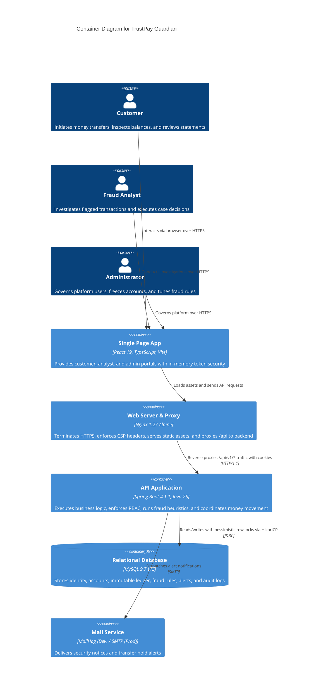
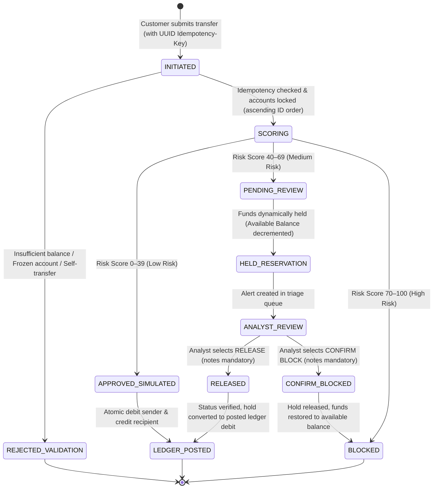
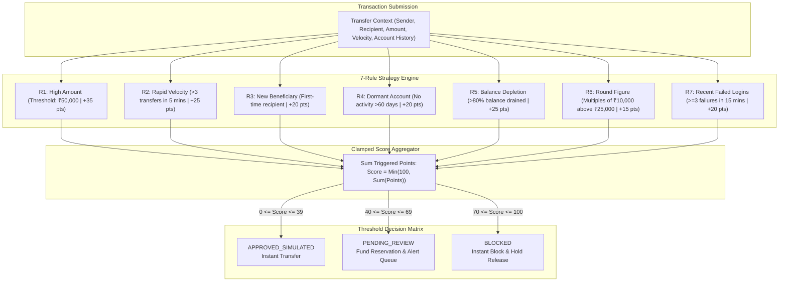
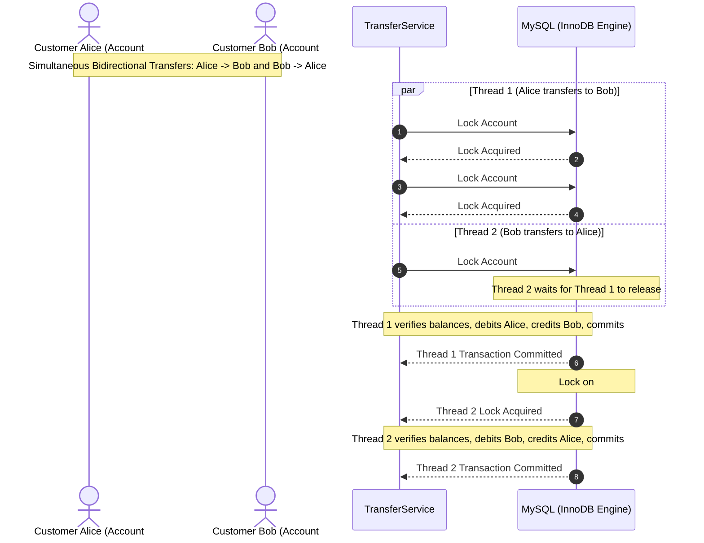

# TrustPay Guardian — Technical Architecture & System Design

**Document Version:** 1.0.0  
**Target Release:** `v1.0.0`  
**Classification:** Core System Architecture Specification  
**Last Updated:** 2026-10-26  

---

## 1. System Context & Container Model (C4 Level 2)



---

## 2. Transaction Lifecycle & Finite State Machine (FSM)

A transaction strictly transitions through deterministic states governed by the Fraud Engine, ledger balances, and analyst intervention:



---

## 3. Fraud Engine Strategy Pipeline & Scoring Architecture

The Fraud Engine implements the GoF Strategy Pattern. Each rule operates as an independent, unit-testable Spring component:



---

## 4. Concurrency & Deadlock-Free Row Locking

To prevent race conditions and eliminate database deadlocks when two parties transfer money to each other simultaneously, `TransferService` sorts account IDs in ascending numerical order before acquiring exclusive pessimistic write locks:



---

## 5. Client Token Lifecycle & Silent Refresh Flow

```mermaid
sequenceDiagram
    autonumber
    actor User as Browser Client (React)
    participant Axios as axiosClient.ts (In-Memory)
    participant API as Spring Boot Security

    User->>Axios: User logs in with email & password
    Axios->>API: POST /api/v1/auth/login
    API-->>Axios: 200 OK + Body: { accessToken: "jwt..." } + Set-Cookie: refreshToken=...; HttpOnly; SameSite=Strict
    Note over Axios: Access token stored strictly in volatile memory

    User->>Axios: Triggers authenticated request (GET /accounts)
    Axios->>API: GET /accounts (Authorization: Bearer <accessToken>)
    API-->>Axios: 401 Unauthorized (Access Token Expired)

    Note over Axios: Interceptor intercepts 401, pauses queue, initiates silent refresh
    Axios->>API: POST /api/v1/auth/refresh (Cookie: refreshToken automatically attached)
    API-->>Axios: 200 OK + Body: { accessToken: "new_jwt..." } + Rotated Set-Cookie
    Note over Axios: In-memory token updated; retries queued original request

    Axios->>API: GET /accounts (Authorization: Bearer <new_jwt>)
    API-->>Axios: 200 OK + Accounts Data
    Axios-->>User: Seamlessly displays data without user re-login
```
