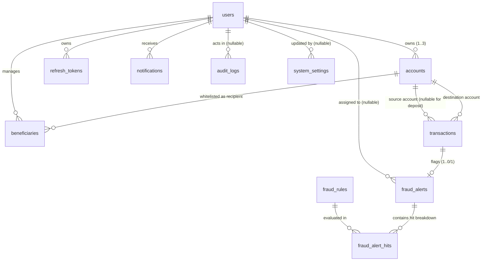
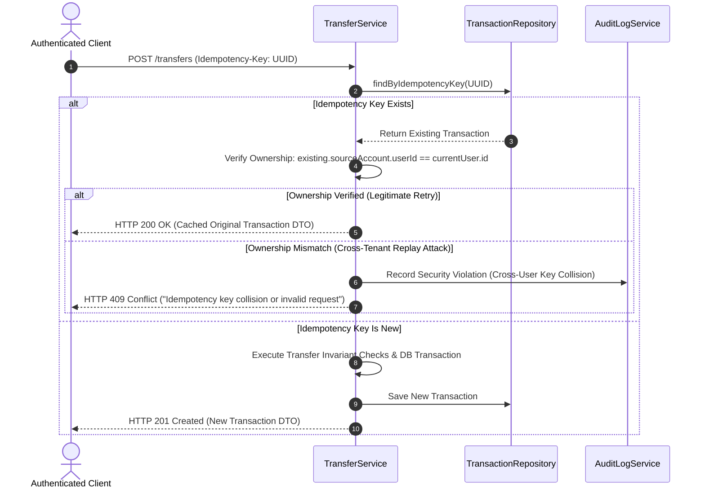
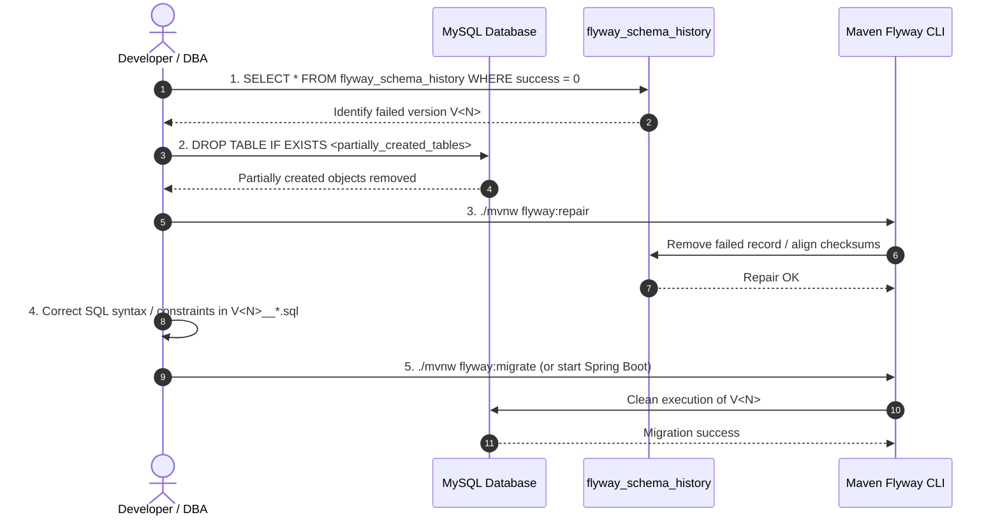

# TrustPay Guardian — Database Design & Flyway Migration Plan

**System:** TrustPay Guardian: Fraud-Aware Digital Banking Platform  
**Target Engine:** MySQL Community Server 8.4.11 LTS (Port 3306)  
**Schema Tool:** Flyway Migration Engine (V1–V6)  
**Architecture:** Modular Monolith Relational Model  
**Date:** 2026-10-17  
**Status:** PROPOSED — Pre-Phase 2 Comprehensive Architectural Review  

---

## 1. Canonical Relational Entities (11 Tables)

TrustPay Guardian strictly preserves the 11 canonical entities defined in the product specification. All monetary amounts are stored in fixed-precision `DECIMAL(19,2)`, all timestamps use microsecond-precision UTC `DATETIME(6)`, and enumerations are represented as `VARCHAR` columns validated by explicit database `CHECK` constraints.



---

### 1.1 `users`
- **Purpose:** Stores customer, fraud analyst, and system administrator identities, hashed credentials, and authentication security state.
- **Columns:**
  - `id` `BIGINT AUTO_INCREMENT` (PK)
  - `full_name` `VARCHAR(80) NOT NULL` (Customer full legal name)
  - `email` `VARCHAR(150) NOT NULL` (Unique, stored lower-cased)
  - `phone_number` `VARCHAR(15) NOT NULL` (10-digit Indian mobile number with optional prefix)
  - `password_hash` `VARCHAR(100) NOT NULL` (BCrypt hash with work factor cost 12)
  - `role` `VARCHAR(20) NOT NULL` (`CUSTOMER`, `FRAUD_ANALYST`, `ADMIN`)
  - `status` `VARCHAR(20) NOT NULL DEFAULT 'ACTIVE'` (`ACTIVE`, `SUSPENDED`, `DEACTIVATED`)
  - `failed_login_attempts` `INT NOT NULL DEFAULT 0` (Consecutive failure counter)
  - `lockout_until` `DATETIME(6) NULL` (Set to UTC expiration when failures reach 5)
  - `last_login_at` `DATETIME(6) NULL`
  - `created_at` `DATETIME(6) NOT NULL`
  - `updated_at` `DATETIME(6) NOT NULL`
- **Constraints & Indexes:**
  - `CONSTRAINT pk_users PRIMARY KEY (id)`
  - `CONSTRAINT uk_users_email UNIQUE (email)`
  - `CONSTRAINT chk_users_role CHECK (role IN ('CUSTOMER', 'FRAUD_ANALYST', 'ADMIN'))`
  - `CONSTRAINT chk_users_status CHECK (status IN ('ACTIVE', 'SUSPENDED', 'DEACTIVATED'))`
  - `CONSTRAINT chk_users_failed_attempts CHECK (failed_login_attempts >= 0)`
  - `INDEX idx_users_role (role)`
  - `INDEX idx_users_status (status)`

---

### 1.2 `accounts`
- **Purpose:** Simulated deposit accounts (`SAVINGS` or `CURRENT`). Supports up to 3 accounts per customer.
- **Columns:**
  - `id` `BIGINT AUTO_INCREMENT` (PK)
  - `user_id` `BIGINT NOT NULL` (FK -> `users.id`)
  - `account_number` `VARCHAR(20) NOT NULL` (Unique synthetic identifier, e.g., `TPG100000001`)
  - `account_type` `VARCHAR(20) NOT NULL DEFAULT 'SAVINGS'` (`SAVINGS`, `CURRENT`)
  - `currency` `VARCHAR(3) NOT NULL DEFAULT 'INR'` (Strictly fixed-currency INR)
  - `balance` `DECIMAL(19,2) NOT NULL DEFAULT 10000.00` (Posted ledger balance; never float)
  - `status` `VARCHAR(20) NOT NULL DEFAULT 'ACTIVE'` (`ACTIVE`, `FROZEN`, `CLOSED`)
  - `daily_limit` `DECIMAL(19,2) NOT NULL DEFAULT 100000.00` (Max cumulative daily outgoing transfer limit)
  - `created_at` `DATETIME(6) NOT NULL`
  - `updated_at` `DATETIME(6) NOT NULL`
- **Constraints & Indexes:**
  - `CONSTRAINT pk_accounts PRIMARY KEY (id)`
  - `CONSTRAINT fk_accounts_user FOREIGN KEY (user_id) REFERENCES users(id) ON DELETE RESTRICT`
  - `CONSTRAINT uk_accounts_number UNIQUE (account_number)`
  - `CONSTRAINT chk_accounts_balance_non_negative CHECK (balance >= 0.00)`
  - `CONSTRAINT chk_accounts_daily_limit_positive CHECK (daily_limit >= 0.00)`
  - `CONSTRAINT chk_accounts_type CHECK (account_type IN ('SAVINGS', 'CURRENT'))`
  - `CONSTRAINT chk_accounts_status CHECK (status IN ('ACTIVE', 'FROZEN', 'CLOSED'))`
  - `CONSTRAINT chk_accounts_currency CHECK (currency = 'INR')`
  - `INDEX idx_accounts_user_id (user_id)`
  - `INDEX idx_accounts_status (status)`

---

### 1.3 `beneficiaries`
- **Purpose:** Whitelisted transfer recipient accounts saved by a customer.
- **Columns:**
  - `id` `BIGINT AUTO_INCREMENT` (PK)
  - `user_id` `BIGINT NOT NULL` (FK -> `users.id`, the customer owning the beneficiary address book entry)
  - `recipient_account_id` `BIGINT NOT NULL` (FK -> `accounts.id`, the destination account)
  - `nickname` `VARCHAR(50) NOT NULL` (User-friendly label, e.g., "Landlord", "Mom")
  - `created_at` `DATETIME(6) NOT NULL` (Timestamp used by fraud rule R4 to detect new beneficiaries < 24 hours old)
- **Constraints & Indexes:**
  - `CONSTRAINT pk_beneficiaries PRIMARY KEY (id)`
  - `CONSTRAINT fk_beneficiaries_user FOREIGN KEY (user_id) REFERENCES users(id) ON DELETE CASCADE`
  - `CONSTRAINT fk_beneficiaries_recipient FOREIGN KEY (recipient_account_id) REFERENCES accounts(id) ON DELETE RESTRICT`
  - `CONSTRAINT uk_beneficiaries_user_recipient UNIQUE (user_id, recipient_account_id)`
  - `INDEX idx_beneficiaries_user_id (user_id)`
  - `INDEX idx_beneficiaries_created_at (created_at)`

---

### 1.4 `transactions`
- **Purpose:** Immutable journal of all simulated transfers and deposits, fraud scores, and execution lifecycle status.
- **Columns:**
  - `id` `BIGINT AUTO_INCREMENT` (PK)
  - `reference_id` `VARCHAR(20) NOT NULL` (Unique business identifier: `TXN-` + 12 alphanumeric chars)
  - `idempotency_key` `VARCHAR(64) NOT NULL` (Unique client-generated UUIDv4)
  - `source_account_id` `BIGINT NULL` (FK -> `accounts.id`, NULL for external simulated deposits)
  - `destination_account_id` `BIGINT NOT NULL` (FK -> `accounts.id`)
  - `amount` `DECIMAL(19,2) NOT NULL` (Fixed-precision transfer amount)
  - `currency` `VARCHAR(3) NOT NULL DEFAULT 'INR'`
  - `type` `VARCHAR(20) NOT NULL` (`TRANSFER`, `DEPOSIT`)
  - `status` `VARCHAR(25) NOT NULL` (`PENDING_REVIEW`, `APPROVED_SIMULATED`, `BLOCKED`, `REJECTED`, `CANCELLED`)
  - `risk_score` `INT NULL` (Calculated composite risk score 0–100; NULL for deposits)
  - `failure_reason` `VARCHAR(255) NULL` (Detailed failure, rejection, or block rationale)
  - `created_at` `DATETIME(6) NOT NULL`
  - `completed_at` `DATETIME(6) NULL`
- **Constraints & Indexes:**
  - `CONSTRAINT pk_transactions PRIMARY KEY (id)`
  - `CONSTRAINT fk_tx_source FOREIGN KEY (source_account_id) REFERENCES accounts(id) ON DELETE RESTRICT`
  - `CONSTRAINT fk_tx_destination FOREIGN KEY (destination_account_id) REFERENCES accounts(id) ON DELETE RESTRICT`
  - `CONSTRAINT uk_tx_reference UNIQUE (reference_id)`
  - `CONSTRAINT uk_tx_idempotency UNIQUE (idempotency_key)`
  - `CONSTRAINT chk_tx_amount_positive CHECK (amount > 0.00)`
  - `CONSTRAINT chk_tx_type CHECK (type IN ('TRANSFER', 'DEPOSIT'))`
  - `CONSTRAINT chk_tx_status CHECK (status IN ('PENDING_REVIEW', 'APPROVED_SIMULATED', 'BLOCKED', 'REJECTED', 'CANCELLED'))`
  - `CONSTRAINT chk_tx_currency CHECK (currency = 'INR')`
  - `CONSTRAINT chk_tx_risk_score CHECK (risk_score IS NULL OR (risk_score >= 0 AND risk_score <= 100))`
  - `CONSTRAINT chk_tx_type_source CHECK ((type = 'TRANSFER' AND source_account_id IS NOT NULL) OR (type = 'DEPOSIT' AND source_account_id IS NULL))`
  - `CONSTRAINT chk_tx_distinct_accounts CHECK (source_account_id IS NULL OR source_account_id <> destination_account_id)`
  - `INDEX idx_tx_source (source_account_id)`
  - `INDEX idx_tx_destination (destination_account_id)`
  - `INDEX idx_tx_status (status)`
  - `INDEX idx_tx_created_at (created_at)`
  - `INDEX idx_tx_source_created (source_account_id, created_at)`

---

### 1.5 `fraud_rules`
- **Purpose:** Configurable definitions for the 7 canonical fraud detection rules (R1–R7) with point contributions and JSON parameters.
- **Columns:**
  - `id` `BIGINT AUTO_INCREMENT` (PK)
  - `rule_code` `VARCHAR(30) NOT NULL` (Unique canonical key: `R1`, `R2`, `R3`, `R4`, `R5`, `R6`, `R7`)
  - `name` `VARCHAR(100) NOT NULL`
  - `description` `VARCHAR(255) NOT NULL`
  - `points` `INT NOT NULL` (Risk points contributed if rule triggers)
  - `is_enabled` `BOOLEAN NOT NULL DEFAULT TRUE` (Master switch for rule evaluation)
  - `parameters_json` `TEXT NULL` (JSON-encoded thresholds, e.g. `{"threshold_amount": 50000.00}`)
  - `updated_at` `DATETIME(6) NOT NULL`
- **Constraints & Indexes:**
  - `CONSTRAINT pk_fraud_rules PRIMARY KEY (id)`
  - `CONSTRAINT uk_fraud_rules_code UNIQUE (rule_code)`
  - `CONSTRAINT chk_fraud_rules_points CHECK (points >= 0 AND points <= 100)`
  - `INDEX idx_fraud_rules_enabled (is_enabled)`

---

### 1.6 `fraud_alerts`
- **Purpose:** Flagged security cases generated when a transfer's composite risk score meets or exceeds the review threshold ($\ge 40$).
- **Columns:**
  - `id` `BIGINT AUTO_INCREMENT` (PK)
  - `transaction_id` `BIGINT NOT NULL` (FK -> `transactions.id`, 1-to-1 relationship)
  - `risk_score` `INT NOT NULL` (Snapshot of total calculated score, 0–100)
  - `risk_level` `VARCHAR(15) NOT NULL` (`LOW`, `MEDIUM`, `HIGH`)
  - `status` `VARCHAR(25) NOT NULL DEFAULT 'OPEN'` (`OPEN`, `IN_REVIEW`, `RESOLVED_RELEASED`, `RESOLVED_BLOCKED`)
  - `assigned_to` `BIGINT NULL` (FK -> `users.id`, the fraud analyst reviewing the case)
  - `decision_notes` `TEXT NULL` (Mandatory explanation upon case resolution)
  - `created_at` `DATETIME(6) NOT NULL`
  - `resolved_at` `DATETIME(6) NULL`
- **Constraints & Indexes:**
  - `CONSTRAINT pk_fraud_alerts PRIMARY KEY (id)`
  - `CONSTRAINT fk_fraud_alerts_tx FOREIGN KEY (transaction_id) REFERENCES transactions(id) ON DELETE RESTRICT`
  - `CONSTRAINT fk_fraud_alerts_user FOREIGN KEY (assigned_to) REFERENCES users(id) ON DELETE SET NULL`
  - `CONSTRAINT uk_fraud_alerts_tx UNIQUE (transaction_id)`
  - `CONSTRAINT chk_fraud_alerts_score CHECK (risk_score >= 0 AND risk_score <= 100)`
  - `CONSTRAINT chk_fraud_alerts_level CHECK (risk_level IN ('LOW', 'MEDIUM', 'HIGH'))`
  - `CONSTRAINT chk_fraud_alerts_status CHECK (status IN ('OPEN', 'IN_REVIEW', 'RESOLVED_RELEASED', 'RESOLVED_BLOCKED'))`
  - `INDEX idx_fraud_alerts_status (status)`
  - `INDEX idx_fraud_alerts_created_at (created_at)`
  - `INDEX idx_fraud_alerts_assigned (assigned_to)`

---

### 1.7 `fraud_alert_hits`
- **Purpose:** Explainable, transparent audit breakdown detailing exactly which rules triggered for a specific alert and their point contributions.
- **Columns:**
  - `id` `BIGINT AUTO_INCREMENT` (PK)
  - `alert_id` `BIGINT NOT NULL` (FK -> `fraud_alerts.id`)
  - `rule_code` `VARCHAR(30) NOT NULL` (FK -> `fraud_rules.rule_code`)
  - `score_contribution` `INT NOT NULL` (Points added by this rule)
  - `reason_explanation` `VARCHAR(255) NOT NULL` (Human-readable rationale, e.g. "Amount ₹65,000 exceeds ₹50,000 threshold")
  - `created_at` `DATETIME(6) NOT NULL`
- **Constraints & Indexes:**
  - `CONSTRAINT pk_fraud_alert_hits PRIMARY KEY (id)`
  - `CONSTRAINT fk_alert_hits_alert FOREIGN KEY (alert_id) REFERENCES fraud_alerts(id) ON DELETE CASCADE`
  - `CONSTRAINT fk_alert_hits_rule FOREIGN KEY (rule_code) REFERENCES fraud_rules(rule_code) ON DELETE RESTRICT ON UPDATE CASCADE`
  - `CONSTRAINT chk_alert_hits_score CHECK (score_contribution >= 0)`
  - `INDEX idx_alert_hits_alert_id (alert_id)`
  - `INDEX idx_alert_hits_rule_code (rule_code)`

> [!NOTE]
> **Referential Integrity Design Decision on `rule_code`:**
> `fraud_alert_hits.rule_code` has a formal foreign key to `fraud_rules.rule_code` with `ON DELETE RESTRICT ON UPDATE CASCADE`. In banking audit compliance, historical fraud explanations must remain referentially valid. Deleting a rule that has triggered historical alerts is strictly prohibited (`RESTRICT`). Instead, obsolete rules are disabled via `is_enabled = FALSE`.

---

### 1.8 `refresh_tokens`
- **Purpose:** Server-side persistence of hashed refresh tokens for 7-day session rotation, expiry, and reuse detection.
- **Columns:**
  - `id` `BIGINT AUTO_INCREMENT` (PK)
  - `user_id` `BIGINT NOT NULL` (FK -> `users.id`)
  - `token_hash` `VARCHAR(64) NOT NULL` (Unique SHA-256 hexadecimal hash; raw token is never stored)
  - `expires_at` `DATETIME(6) NOT NULL` (UTC timestamp)
  - `revoked_at` `DATETIME(6) NULL` (Timestamp when rotated or manually revoked)
  - `replaced_by_hash` `VARCHAR(64) NULL` (Token chain pointer used to detect token reuse attacks)
  - `created_at` `DATETIME(6) NOT NULL`
- **Constraints & Indexes:**
  - `CONSTRAINT pk_refresh_tokens PRIMARY KEY (id)`
  - `CONSTRAINT fk_refresh_tokens_user FOREIGN KEY (user_id) REFERENCES users(id) ON DELETE CASCADE`
  - `CONSTRAINT uk_refresh_tokens_hash UNIQUE (token_hash)`
  - `INDEX idx_refresh_tokens_user (user_id)`
  - `INDEX idx_refresh_tokens_expires (expires_at)`

---

### 1.9 `notifications`
- **Purpose:** In-app real-time notification records for transfer debits/credits, security holds, account freezes, and analyst decisions.
- **Columns:**
  - `id` `BIGINT AUTO_INCREMENT` (PK)
  - `user_id` `BIGINT NOT NULL` (FK -> `users.id`)
  - `type` `VARCHAR(30) NOT NULL` (`TRANSFER_RECEIVED`, `TRANSFER_SENT`, `TRANSFER_HELD`, `TRANSFER_BLOCKED`, `TRANSFER_RELEASED`, `ACCOUNT_FROZEN`, `ACCOUNT_UNFROZEN`, `SECURITY_ALERT`)
  - `title` `VARCHAR(100) NOT NULL`
  - `message` `TEXT NOT NULL`
  - `read_at` `DATETIME(6) NULL`
  - `created_at` `DATETIME(6) NOT NULL`
- **Constraints & Indexes:**
  - `CONSTRAINT pk_notifications PRIMARY KEY (id)`
  - `CONSTRAINT fk_notifications_user FOREIGN KEY (user_id) REFERENCES users(id) ON DELETE CASCADE`
  - `INDEX idx_notifications_user_unread (user_id, read_at)`
  - `INDEX idx_notifications_created_at (created_at)`

---

### 1.10 `audit_logs`
- **Purpose:** Append-only, tamper-evident journal recording all administrative mutations, analyst fraud adjudications, and security events.
- **Columns:**
  - `id` `BIGINT AUTO_INCREMENT` (PK)
  - `actor_user_id` `BIGINT NULL` (FK -> `users.id`, NULL for system-initiated automated events)
  - `action` `VARCHAR(50) NOT NULL` (`USER_STATUS_CHANGE`, `USER_ROLE_CHANGE`, `FRAUD_RULE_UPDATE`, `SYSTEM_SETTING_UPDATE`, `ALERT_DECISION_RELEASE`, `ALERT_DECISION_BLOCK`, `ACCOUNT_FREEZE`, `ACCOUNT_UNFREEZE`)
  - `target_type` `VARCHAR(30) NOT NULL` (`USER`, `ACCOUNT`, `FRAUD_RULE`, `FRAUD_ALERT`, `SYSTEM_SETTING`, `TRANSACTION`)
  - `target_id` `VARCHAR(64) NOT NULL` (Primary key of affected entity)
  - `details_json` `TEXT NULL` (JSON delta of previous and updated values)
  - `ip_address` `VARCHAR(45) NULL` (IPv4 or IPv6 client address)
  - `request_id` `VARCHAR(64) NULL` (Traceable HTTP correlation ID)
  - `created_at` `DATETIME(6) NOT NULL`
- **Constraints & Indexes:**
  - `CONSTRAINT pk_audit_logs PRIMARY KEY (id)`
  - `CONSTRAINT fk_audit_logs_actor FOREIGN KEY (actor_user_id) REFERENCES users(id) ON DELETE SET NULL`
  - `INDEX idx_audit_logs_actor (actor_user_id)`
  - `INDEX idx_audit_logs_action (action)`
  - `INDEX idx_audit_logs_created_at (created_at)`
  - `INDEX idx_audit_logs_target (target_type, target_id)`

---

### 1.11 `system_settings`
- **Purpose:** Dynamic global banking and risk parameters editable by administrators via the admin console.
- **Columns:**
  - `id` `BIGINT AUTO_INCREMENT` (PK)
  - `setting_key` `VARCHAR(50) NOT NULL` (Unique configuration key)
  - `setting_value` `VARCHAR(100) NOT NULL` (String-encoded value, e.g., "40", "100000.00")
  - `description` `VARCHAR(255) NOT NULL`
  - `updated_at` `DATETIME(6) NOT NULL`
  - `updated_by` `BIGINT NULL` (FK -> `users.id`)
- **Constraints & Indexes:**
  - `CONSTRAINT pk_system_settings PRIMARY KEY (id)`
  - `CONSTRAINT uk_system_settings_key UNIQUE (setting_key)`
  - `CONSTRAINT fk_system_settings_user FOREIGN KEY (updated_by) REFERENCES users(id) ON DELETE SET NULL`

---

## 2. Flyway Migration Plan (V1 to V6)

The relational schema is constructed incrementally using six versioned SQL migration scripts located in `backend/src/main/resources/db/migration/`. Every script respects strict foreign-key dependency ordering.

```
V1__create_users_and_accounts.sql
V2__create_beneficiaries_and_transactions.sql
V3__create_fraud_tables.sql
V4__create_auth_notifications_audit.sql
V5__create_system_settings.sql
V6__seed_fraud_rules_and_settings.sql
```

### 2.1 Migration Dependency Validation
1. **`V1__create_users_and_accounts.sql`**
   - Creates root entities `users` (no FK) and `accounts` (FK -> `users.id`).
   - Declares baseline uniqueness and CHECK constraints for balances, roles, and account statuses.
2. **`V2__create_beneficiaries_and_transactions.sql`**
   - Creates `beneficiaries` (FKs -> `users.id`, `accounts.id` from V1).
   - Creates `transactions` (FKs -> `accounts.id` for both source and destination from V1).
   - Adds compound uniqueness `(user_id, recipient_account_id)`, positive amount check, type/source consistency check, distinct accounts check, and risk score range check.
3. **`V3__create_fraud_tables.sql`**
   - Creates `fraud_rules` (no FK; unique `rule_code`).
   - Creates `fraud_alerts` (FK -> `transactions.id` from V2, FK -> `users.id` from V1).
   - Creates `fraud_alert_hits` (FK -> `fraud_alerts.id` from V3, FK -> `fraud_rules.rule_code` from V3).
4. **`V4__create_auth_notifications_audit.sql`**
   - Creates `refresh_tokens` (FK -> `users.id` from V1).
   - Creates `notifications` (FK -> `users.id` from V1).
   - Creates `audit_logs` (FK -> `users.id` from V1).
5. **`V5__create_system_settings.sql`**
   - Creates `system_settings` (FK -> `users.id` from V1).
6. **`V6__seed_fraud_rules_and_settings.sql`**
   - Seeds baseline platform settings and the 7 canonical fraud detection rules.

### 2.2 Repeatable & Idempotent Seeding Contract (`V6`)
To ensure migration reruns, local environment resets, and continuous integration pipelines execute reliably without duplicate-key errors, `V6` uses idempotent `INSERT ... ON DUPLICATE KEY UPDATE` statements:

```sql
-- Seed Platform System Settings idempotently
INSERT INTO system_settings (setting_key, setting_value, description, updated_at)
VALUES
  ('REVIEW_THRESHOLD', '40', 'Composite risk score threshold to hold transfer for review', UTC_TIMESTAMP(6)),
  ('BLOCK_THRESHOLD', '70', 'Composite risk score threshold to automatically block transfer', UTC_TIMESTAMP(6)),
  ('DEMO_OPENING_BALANCE', '10000.00', 'Initial demo opening balance for newly registered customer accounts', UTC_TIMESTAMP(6)),
  ('MAX_TRANSFER_AMOUNT', '200000.00', 'Maximum allowable single simulated transfer amount in INR', UTC_TIMESTAMP(6)),
  ('MAX_DEPOSIT_AMOUNT', '50000.00', 'Maximum allowable single simulated deposit amount in INR', UTC_TIMESTAMP(6)),
  ('DEFAULT_DAILY_LIMIT', '100000.00', 'Default daily outgoing transfer limit per account in INR', UTC_TIMESTAMP(6))
ON DUPLICATE KEY UPDATE
  description = VALUES(description),
  updated_at = VALUES(updated_at);

-- Seed 7 Canonical Fraud Rules idempotently
INSERT INTO fraud_rules (rule_code, name, description, points, is_enabled, parameters_json, updated_at)
VALUES
  ('R1', 'HIGH_AMOUNT', 'Flags transactions with transfer amount >= threshold', 30, TRUE, '{"threshold_amount": 50000.00}', UTC_TIMESTAMP(6)),
  ('R2', 'VELOCITY', 'Flags rapid repeated transfers from same source account', 25, TRUE, '{"window_minutes": 10, "max_transfers": 4}', UTC_TIMESTAMP(6)),
  ('R3', 'UNUSUAL_HOUR', 'Flags transfers initiated between 00:00 and 04:59 Asia/Kolkata', 15, TRUE, '{"start_hour": 0, "end_hour": 4, "timezone": "Asia/Kolkata"}', UTC_TIMESTAMP(6)),
  ('R4', 'NEW_BENEFICIARY_LARGE', 'Flags high-value transfers to newly added beneficiaries (< 24 hrs)', 30, TRUE, '{"window_hours": 24, "threshold_amount": 20000.00}', UTC_TIMESTAMP(6)),
  ('R5', 'AMOUNT_SPIKE', 'Flags transfers exceeding 5x 30-day historical average', 20, TRUE, '{"multiplier": 5.0, "window_days": 30, "min_history_count": 3}', UTC_TIMESTAMP(6)),
  ('R6', 'DAILY_LIMIT_PROXIMITY', 'Flags transfers causing daily cumulative total to exceed 90% of daily limit', 10, TRUE, '{"proximity_ratio": 0.90}', UTC_TIMESTAMP(6)),
  ('R7', 'RECENT_FAILED_LOGINS', 'Flags transfers originating from users with >= 3 failed logins in last 30 mins', 15, TRUE, '{"window_minutes": 30, "min_failed_attempts": 3}', UTC_TIMESTAMP(6))
ON DUPLICATE KEY UPDATE
  name = VALUES(name),
  description = VALUES(description),
  points = VALUES(points),
  parameters_json = VALUES(parameters_json),
  updated_at = VALUES(updated_at);
```

---

## 3. Financial Integrity, Concurrency, and Idempotency Architecture

### 3.1 Balance Definitions and Fund Lifecycle Semantics

A core flaw in naive banking implementations is deducting money immediately when a transfer is flagged for fraud review, or failing to reserve funds, which allows customers to double-spend. TrustPay Guardian strictly defines balance and lifecycle semantics:

```
                            +-----------------------+
                            | Transfer Initiated    |
                            +-----------+-----------+
                                        |
                             [Evaluate Fraud Score]
                                        |
                 +----------------------+----------------------+
                 |                      |                      |
            Score < 40             Score 40-69            Score >= 70
                 |                      |                      |
                 v                      v                      v
        +-----------------+    +-----------------+    +-----------------+
        | Direct Approval |    | PENDING_REVIEW  |    |     BLOCKED     |
        | Sender Debited  |    | Funds Reserved  |    | No Money Moved  |
        | Recipient Cred. |    | Ledger Intact   |    | Alert Flagged   |
        +-----------------+    +--------+--------+    +--------+--------+
                                        |                      |
                               [Analyst Decision]      [Analyst Decision]
                                        |                      |
                       +----------------+---------------+      |
                       |                                |      |
                  [RELEASE]                      [CONFIRM_BLOCK]|
                       |                                |      |
                       v                                v      v
              +-----------------+              +-----------------+
              | Re-check Status |              | Reservation     |
              | Re-check Avail. |              | Released        |
              | Sender Debited  |              | Status Fixed as |
              | Recipient Cred. |              | BLOCKED/REJECTED|
              +-----------------+              +-----------------+
```

#### Exact Definitions:
1. **Posted Ledger Balance (`accounts.balance`):**
   - The authoritative posted accounting balance stored in the database.
   - Updated **only** when a transfer is finalized into `APPROVED_SIMULATED`.
   - Never deducted or altered while a transaction is in `PENDING_REVIEW` or `BLOCKED`.
2. **Available Balance (`available_balance`):**
   - The maximum amount a customer can spend or transfer at any given instant.
   - Calculated dynamically by subtracting active pending outgoing fund reservations from the ledger balance:
     $$\text{Available Balance} = \text{accounts.balance} - \sum_{\substack{t \in \text{transactions} \\ t.\text{source\_account\_id} = \text{account.id} \\ t.\text{status} = \text{'PENDING\_REVIEW'}}} t.\text{amount}$$
   - Any new transfer request is validated against $\text{Available Balance} \ge \text{amount}$. If available balance is insufficient, the transfer fails immediately with an `InsufficientFundsException` before any fraud evaluation or database write.
3. **Fund Reservation Semantics:**
   - When a transaction enters `PENDING_REVIEW` (score 40–69), its amount is automatically locked against the sender's available balance through the dynamic pending reservation formula.
   - The customer cannot spend those reserved funds on subsequent transfers, preventing overdrafts.
   - The recipient's account does **not** receive the funds yet.
4. **Transfer Completion Semantics (`APPROVED_SIMULATED`):**
   - Occurs either immediately (if risk score $< 40$) or upon analyst `RELEASE`.
   - Executed atomically:
     - Sender ledger balance: `balance = balance - amount`.
     - Recipient ledger balance: `balance = balance + amount`.
     - Transaction record updated: `status = 'APPROVED_SIMULATED'`, `completed_at = UTC_TIMESTAMP(6)`.
     - When released from `PENDING_REVIEW`, the reservation naturally converts to a posted debit.
5. **Cancellation Semantics (`CANCELLED`):**
   - If a pending review transaction is cancelled (e.g. by customer before review or system timeout), the transaction status transitions to `CANCELLED`.
   - No ledger balance changes occur.
   - The amount ceases to be in `PENDING_REVIEW`, immediately restoring the customer's available balance.
6. **Rejection Semantics (`REJECTED`):**
   - If a transfer fails preliminary validation (insufficient funds, daily limit breach, account frozen), it is rejected without reserving funds.
7. **Blocking Semantics (`BLOCKED`):**
   - If a transaction evaluates to risk score $\ge 70$, it is halted in `BLOCKED` status.
   - No funds are transferred to the recipient.
   - An open HIGH-severity fraud alert is dispatched to analysts.
   - If the analyst confirms the block (`CONFIRM_BLOCK`), the transaction remains permanently `BLOCKED`, and any held reservation is released.
8. **Account Freeze Semantics (`accounts.status = 'FROZEN'`):**
   - An account with status `FROZEN` is barred from both initiating transfers (`source_account_id`) and receiving transfers (`destination_account_id`).
   - If an account is frozen while a transaction is awaiting review, subsequent analyst `RELEASE` is aborted during the mandatory pre-execution status re-check.

---

### 3.2 Atomic Transfer Execution & Concurrency Safety

#### Step-by-Step Transaction Execution Flow
All transfers run within a Spring `@Transactional(isolation = Isolation.READ_COMMITTED)` boundary.

1. **Phase A: Pre-Lock Validation (Service Layer)**
   - Verify `type == 'TRANSFER'`, `amount > 0.00`, and `currency == 'INR'`.
   - Verify `source_account_id != destination_account_id`.
   - Verify authenticated customer owns `source_account_id` (IDOR check).
   - Verify beneficiary ownership and existence (if transferring to a saved beneficiary).
2. **Phase B: Ascending Pessimistic Row Locking**
   - To prevent deadlocks from concurrent inverted transfers (Account A $\to$ Account B vs Account B $\to$ Account A), row locks on the `accounts` table are **always acquired in strictly ascending primary key order**:
     ```java
     long firstId = Math.min(sourceAccountId, destAccountId);
     long secondId = Math.max(sourceAccountId, destAccountId);

     Account firstAccount = accountRepository.findByIdForUpdate(firstId)
         .orElseThrow(() -> new AccountNotFoundException(firstId));
     Account secondAccount = accountRepository.findByIdForUpdate(secondId)
         .orElseThrow(() -> new AccountNotFoundException(secondId));

     Account source = (sourceAccountId == firstId) ? firstAccount : secondAccount;
     Account destination = (destAccountId == firstId) ? firstAccount : secondAccount;
     ```
3. **Phase C: Post-Lock Invariant Verification**
   - Verify both accounts have `status == 'ACTIVE'`. If either is `FROZEN` or `CLOSED`, abort and throw `AccountStatusException`.
   - Calculate exact available balance on the freshly locked source account. Verify $\text{Available Balance} \ge \text{amount}$.
   - Calculate current day's cumulative outgoing transfers. Verify $\text{Daily Total} + \text{amount} \le \text{source.dailyLimit}$.
4. **Phase D: Fraud Rule Scoring Engine (R1–R7)**
   - Evaluate the 7 deterministic rules against historical database activity and request metadata.
   - Aggregate points into a composite score (capped at 100).
5. **Phase E: Conditional Persistence & State Execution**
   - **Case 1: Direct Approval (Score $< 40$):**
     - Deduct sender: `source.setBalance(source.getBalance().subtract(amount));`
     - Credit recipient: `destination.setBalance(destination.getBalance().add(amount));`
     - Persist `transactions` record with status `APPROVED_SIMULATED`, `risk_score = score`, `completed_at = now`.
     - Both account updates and the transaction insert commit atomically in the same database transaction.
   - **Case 2: Review Hold (Score $40–69$):**
     - Ledger balances remain untouched.
     - Persist `transactions` record with status `PENDING_REVIEW`, `risk_score = score`.
     - Persist `fraud_alerts` record (`status = 'OPEN'`, `risk_level = 'MEDIUM'`).
     - Persist `fraud_alert_hits` breakdown for all triggered rules.
   - **Case 3: Block (Score $\ge 70$):**
     - Ledger balances remain untouched.
     - Persist `transactions` record with status `BLOCKED`, `risk_score = score`, `failure_reason = 'High risk score auto-block'`.
     - Persist `fraud_alerts` record (`status = 'OPEN'`, `risk_level = 'HIGH'`).
     - Persist `fraud_alert_hits` breakdown.

---

### 3.3 Deadlock Analysis & Correction of Theoretical Claims

> [!IMPORTANT]
> **Correction of Deadlock Elimination Claim:**  
> Previous drafts claimed that *“locking rows in strictly ascending primary key order completely eliminates distributed and database deadlocks.”* This statement is technically inaccurate and is hereby corrected.

#### Why Ascending Row Locking Alone Does Not Completely Eliminate Deadlocks:
1. **Direct Pairwise Cycle Elimination Only:**
   Ascending primary-key locking (`min(A, B)` then `max(A, B)`) eliminates **direct pairwise deadlocks** occurring solely on the clustered index of the `accounts` table between two concurrent bidirectional transfers.
2. **Secondary Index & Gap / Next-Key Locks:**
   Queries utilizing secondary indexes (such as `idx_accounts_user_id` or `idx_tx_source`) acquire secondary index record locks and gap locks. The MySQL InnoDB query optimizer determines the order in which secondary index locks and clustered index locks are evaluated. If a concurrent transaction queries accounts via `user_id` while another locks via primary key, an index-order inversion deadlock can occur.
3. **Multi-Table Lock Order Interleaving:**
   A complete transfer transaction interacts with multiple tables: `accounts`, `transactions`, `beneficiaries`, `fraud_alerts`, `fraud_alert_hits`, `notifications`, and `audit_logs`. If another process (e.g., an analyst alert resolution, an admin account freeze, or a user profile update) acquires locks across these tables in a different sequence, an inter-table deadlock cycle can form.
4. **Foreign Key Verification Read Locks:**
   Inserting into `transactions` requires MySQL InnoDB to acquire shared read locks (`S` locks) on the referenced `accounts` rows (`fk_tx_source` and `fk_tx_destination`) to verify referential integrity. If another transaction holds an exclusive (`X`) lock or attempts to upgrade an `S` lock, a lock conversion deadlock can materialize.

#### Required Comprehensive Deadlock Defense Strategy:
To achieve robust concurrency safety under production loads, the application enforces:
- **Strict Application-Wide Table Lock Ordering:** All service-layer transactions adhere to a uniform entity locking sequence: `users` $\to$ `accounts` $\to$ `transactions` $\to$ `fraud_alerts`.
- **Minimized Lock Hold Duration:** Intensive calculations (such as BCrypt password checks, date formatting, or payload serialization) occur strictly *before* database locks are acquired.
- **Application-Level Retry with Exponential Backoff:** Critical transfer and resolution operations are annotated with `@Retryable(retryFor = {CannotAcquireLockException.class, DeadlockLoserDataAccessException.class}, maxAttempts = 3, backoff = @Backoff(delay = 100, maxDelay = 500, multiplier = 2.0, random = true))`.
- **InnoDB Deadlock Timeout Configuration:** Local and production environments configure `innodb_lock_wait_timeout = 5` (seconds) to fail fast rather than stalling connection pools.

---

### 3.4 Idempotency & Cross-Tenant Protection

All transfer requests require a mandatory HTTP header: `Idempotency-Key: <UUIDv4>`. The `transactions` table enforces a database-level `CONSTRAINT uk_tx_idempotency UNIQUE (idempotency_key)`.

#### Security Vulnerability in Naive Idempotency Implementations
In a naive implementation, when an idempotency key duplicate is caught, the application simply queries `findByIdempotencyKey(key)` and returns the existing transaction response payload. **This creates a severe Insecure Direct Object Reference (IDOR) and data exposure vulnerability**:
- If Attacker (User B) submits an `Idempotency-Key` originally used by Victim (User A), a naive service would return User A's transaction payload (including sender/recipient account IDs, amount, transaction reference, and timestamps) to User B!

#### Secure Idempotency Workflow:


1. **Lookup First:** When a transfer request arrives, query `findByIdempotencyKey(headerKey)`.
2. **If Record Exists (Retry Handling):**
   - Perform strict tenant verification: compare `existingTransaction.sourceAccount.userId` against the authenticated caller's `currentUser.getId()`.
   - **Case A (Ownership Matches):** The caller is the authentic user retrying due to a client timeout or network drop. Return the cached transaction DTO with HTTP 200 OK.
   - **Case B (Ownership Mismatches):** The caller is attempting a cross-tenant replay attack or experiencing an unintended UUID collision. Immediately reject with **HTTP 409 Conflict** and a generic error message. Never expose the existing transaction's details. Log an immutable security audit event.
3. **If Record Does Not Exist:**
   - Execute the transfer. If a race condition occurs and two identical requests insert concurrently, the second insert triggers a MySQL duplicate-key violation (`ER_DUP_ENTRY`). The service catches the exception, re-queries within a fresh read transaction, verifies ownership, and returns the original transaction.

---

## 4. Enforcement Responsibility Matrix (Database vs Service Layer)

To ensure high data integrity without compromising performance, responsibilities are clearly partitioned between database constraints and the Spring Boot service layer:

| Requirement / Business Rule | Enforcement Mechanism | Primary Enforcer | Rationale & Technical Details |
| :--- | :--- | :--- | :--- |
| **Non-negative Account Balance** | `CHECK (balance >= 0.00)` | **Database Engine** | Absolute persistence-layer defense against double-spend and overdraft. |
| **Positive Transaction Amount** | `CHECK (amount > 0.00)` | **Database Engine** | Prevents negative or zero-value transactions at the engine level. |
| **Transfer Type / Source Consistency** | `CHECK ((type = 'TRANSFER' AND source_account_id IS NOT NULL) OR (type = 'DEPOSIT' AND source_account_id IS NULL))` | **Database Engine** | Guarantees transfers have a source account and deposits do not. |
| **Distinct Source & Destination Accounts** | `CHECK (source_account_id IS NULL OR source_account_id <> destination_account_id)` | **Database Engine** | Engine-level guarantee that an account cannot transfer funds to itself. |
| **Risk Score Boundaries (0–100)** | `CHECK (risk_score IS NULL OR (risk_score >= 0 AND risk_score <= 100))` | **Database Engine** | Enforces valid scoring limits on `transactions` and `fraud_alerts`. |
| **Entity Uniqueness** | `UNIQUE` indexes on email, account number, reference ID, idempotency key, etc. | **Database Engine** | Hardware-level B-tree unique guarantees against race conditions. |
| **Currency Invariant (`INR`)** | `CHECK (currency = 'INR')` | **Database Engine** | Restricts simulation to single currency across all accounts and transactions. |
| **Available Balance Calculation** | $\text{balance} - \sum(\text{pending})$ | **Spring Boot Service** | MySQL CHECK constraints cannot execute subqueries across rows or tables. |
| **Account Frozen / Closed Status** | Pre-transaction validation & post-lock re-check | **Spring Boot Service** | State machines and multi-step transfer holds require service orchestration. |
| **Beneficiary Ownership Validation** | IDOR check (`beneficiary.userId == current.id`) | **Spring Boot Service** | Multi-table authorization rules belong in application service boundaries. |
| **Self-Beneficiary Prevention** | `recipientAccount.userId != current.id` | **Spring Boot Service** | Validating that a beneficiary is not the user's own account requires multi-table lookup. |
| **Max 3 Accounts per Customer** | Count verification under pessimistic user lock | **Spring Boot Service** | MySQL does not support cross-row count assertions in CHECK constraints. |
| **Daily Transfer Limit Enforcement** | Aggregate query in IST banking day | **Spring Boot Service** | Aggregating today's transactions requires dynamic time-zone and window functions. |
| **Fraud Scoring Engine (R1–R7)** | Deterministic strategy pattern rules | **Spring Boot Service** | Complex business logic (velocity, spike multiplier, time-of-day) belongs in Java. |
| **Analyst Alert Resolution Single-Shot** | State transition validation (`status == OPEN`) | **Spring Boot Service** | Prevents concurrent re-adjudication; returns HTTP 409 Conflict on repeat attempts. |
| **Append-Only Audit Logging** | Runtime permission restriction & non-updatable entity | **Database + Service** | `REVOKE UPDATE, DELETE` at SQL layer + JPA `@Column(updatable = false)`. |
| **Brute-Force Login Lockout** | 5 consecutive failures $\to$ 15-min lockout | **Spring Boot Service** | Authentication security logic managed in Spring Security filter chain. |
| **Admin Self-Demotion Prevention** | Guard in `AdminUserService.updateUserRole` | **Spring Boot Service** | Prevents system lockout; ensures at least one active administrator remains. |

---

## 5. Specific Feature Mechanics & Edge Case Enforcement

### 5.1 Beneficiary Ownership & Validation Rules
- **Recipient Must Exist & Be Active:** When adding a beneficiary, the service verifies that `recipient_account_id` exists in `accounts` and its status is not `CLOSED`.
- **Self-Beneficiary Disallowed:** A customer cannot add their own account as a beneficiary. The service verifies:
  $$\text{accountsRepository.findById(recipientId).getUserId()} \ne \text{currentAuthenticatedUser.getId()}$$
  Violation results in `InvalidBeneficiaryException` (HTTP 400).
- **Compound Uniqueness:** A customer cannot add the same recipient account multiple times (`CONSTRAINT uk_beneficiaries_user_recipient UNIQUE (user_id, recipient_account_id)`).
- **Transfer Authorization:** When a transfer references a saved beneficiary, the service confirms `beneficiary.getUserId().equals(currentUser.getId())`, preventing IDOR access to another customer's beneficiary list.
- **Rule R4 Evaluation:** Rule R4 inspects `beneficiaries.created_at`. If $\text{created\_at} \ge \text{now} - 24\text{ hours}$ and $\text{amount} \ge ₹20,000$, R4 fires (+30 points).

### 5.2 Maximum Accounts per Customer (Limit: 3)
- MySQL cannot declaratively enforce a limit on rows per user via a simple `CHECK` constraint.
- **Enforcement Protocol:**
  1. In `AccountService.createAccount(userId, accountType)`:
  2. Acquire a pessimistic write lock on the customer record (`userRepository.findByIdForUpdate(userId)`). This serializes account creation for that specific user and prevents race conditions from concurrent creation requests.
  3. Query `long count = accountRepository.countByUserId(userId);`.
  4. If `count >= 3`, abort and throw `AccountLimitExceededException` (HTTP 400 Bad Request: "Customers may possess a maximum of 3 accounts").
  5. If `count < 3`, generate a unique account number (`TPG` + 12 digits) and persist the new account.

### 5.3 Daily Transfer Limits (Default: ₹1,00,000)
- Enforced on outgoing transfers per account per banking day (defined from 00:00:00 to 23:59:59.999999 in `Asia/Kolkata` time zone, converted to UTC for database comparison).
- **Enforcement Protocol:**
  1. Determine current IST start-of-day: `ZonedDateTime.now(ZoneId.of("Asia/Kolkata")).truncatedTo(ChronoUnit.DAYS).toInstant()`.
  2. Inside the transfer pessimistic transaction, query:
     ```sql
     SELECT COALESCE(SUM(amount), 0.00)
     FROM transactions
     WHERE source_account_id = :sourceAccountId
       AND created_at >= :startOfDayUtc
       AND status IN ('APPROVED_SIMULATED', 'PENDING_REVIEW');
     ```
     *(Note: `PENDING_REVIEW` transactions MUST be included in the daily total to prevent users from bypassing daily limits while transactions are awaiting analyst review!)*
  3. If $\text{currentDailyTotal} + \text{transferAmount} > \text{sourceAccount.getDailyLimit()}$, throw `DailyLimitExceededException` (HTTP 400 Bad Request).
  4. If $\text{currentDailyTotal} + \text{transferAmount} \ge 0.90 \times \text{sourceAccount.getDailyLimit()}$, Rule R6 (`DAILY_LIMIT_PROXIMITY`) triggers (+10 points).

### 5.4 Append-Only Audit Logging
To ensure regulatory compliance and forensic validity:
1. **Database-Level Privileges:** The runtime database user (`tpg_app`) has `SELECT` and `INSERT` on `audit_logs`, but **no `UPDATE` or `DELETE`** privileges.
2. **JPA Entity Level:** The `AuditLog` entity marks all fields with `@Column(updatable = false)`. The Spring Data repository interface exposes `save()` and read methods only, omitting any `delete()` or bulk mutation operations.
3. **Audit Immutability Invariant:** Once written, an audit log row cannot be modified by any application role, including system administrators.

---

## 6. Database Security & Principle of Least Privilege

To prevent SQL injection attacks from escalating into full schema destruction, TrustPay Guardian separates schema-migration privileges from runtime application privileges.

### 6.1 Two-User Security Model

1. **Schema Migration User (`tpg_flyway`):**
   - Used exclusively by the Flyway migration engine during application startup or CI/CD deployment pipelines.
   - Requires DDL permissions to create and alter tables, constraints, and indexes.
2. **Runtime Application User (`tpg_app`):**
   - Used by the Spring Boot HikariCP connection pool for normal application operation.
   - Strictly restricted to DML operations (`SELECT`, `INSERT`, `UPDATE`, `DELETE`).
   - **Does NOT possess `DROP`, `CREATE`, `ALTER`, `INDEX`, `REFERENCES`, or `GRANT` permissions.**
   - Restricted from updating or deleting rows in `audit_logs`.

### 6.2 Database Initialization Script

The database administrator executes the following setup script once in MySQL Community Server 8.4.11:

```sql
-- 1. Create the database with UTF-8 character encoding
CREATE DATABASE IF NOT EXISTS trustpay_guardian
  CHARACTER SET utf8mb4
  COLLATE utf8mb4_unicode_ci;

-- 2. Create the Flyway migration user (DDL + DML)
CREATE USER IF NOT EXISTS 'tpg_flyway'@'localhost'
  IDENTIFIED BY 'CHANGE_THIS_TO_SECURE_MIGRATION_PASSWORD';

GRANT SELECT, INSERT, UPDATE, DELETE, CREATE, ALTER, DROP, INDEX, REFERENCES
  ON trustpay_guardian.* TO 'tpg_flyway'@'localhost';

-- 3. Create the runtime application user (Least Privilege DML only)
CREATE USER IF NOT EXISTS 'tpg_app'@'localhost'
  IDENTIFIED BY 'CHANGE_THIS_TO_SECURE_APP_PASSWORD';

-- Grant standard DML to runtime application
GRANT SELECT, INSERT, UPDATE, DELETE
  ON trustpay_guardian.* TO 'tpg_app'@'localhost';

-- Defense-in-depth: Revoke mutation privileges on audit_logs for runtime app
REVOKE UPDATE, DELETE
  ON trustpay_guardian.audit_logs FROM 'tpg_app'@'localhost';

FLUSH PRIVILEGES;
```

### 6.3 Spring Boot Dual-DataSource Configuration
In `application.yml`, Spring Boot cleanly delegates migration to `tpg_flyway` while runtime queries use `tpg_app`:

```yaml
spring:
  datasource:
    url: jdbc:mysql://localhost:3306/trustpay_guardian?useSSL=false&serverTimezone=UTC&allowPublicKeyRetrieval=true
    username: ${SPRING_DATASOURCE_USERNAME:tpg_app}
    password: ${SPRING_DATASOURCE_PASSWORD:app_secret}
    driver-class-name: com.mysql.cj.jdbc.Driver
  flyway:
    enabled: true
    user: ${FLYWAY_USER:tpg_flyway}
    password: ${FLYWAY_PASSWORD:migration_secret}
    locations: classpath:db/migration
    validate-on-migrate: true
  jpa:
    hibernate:
      ddl-auto: validate
    properties:
      hibernate:
        format_sql: false
        dialect: org.hibernate.dialect.MySQLDialect
```

---

## 7. MySQL Non-Transactional DDL Failure Recovery & Flyway Repair

### 7.1 The Technical Challenge: MySQL Implicit Commits
In MySQL (including 8.4 LTS), **DDL statements (`CREATE TABLE`, `ALTER TABLE`, `DROP TABLE`) are non-transactional and trigger an implicit commit**. 

If a migration script (e.g. `V3__create_fraud_tables.sql`) successfully executes statement 1 (`CREATE TABLE fraud_rules`) but fails on statement 3 (`CREATE TABLE fraud_alert_hits` due to a syntax error or invalid constraint):
- Tables 1 and 2 **remain committed in the MySQL dictionary**.
- Flyway marks version `3` as failed (`success = 0`) in the `flyway_schema_history` table.
- Future application startups fail immediately with a Flyway migration error.

### 7.2 Why `flyway:repair` Alone Is Insufficient
Running `mvn flyway:repair` only updates the `flyway_schema_history` table by removing the failed migration record. **It does not roll back or drop the partially created MySQL tables**. If a developer runs `flyway:repair` and restarts the application without manual cleanup, Flyway will attempt to re-run `V3`, immediately crashing with:
`Table 'fraud_rules' already exists`.

### 7.3 Step-by-Step Recovery Runbook

When a Flyway migration script fails against MySQL:



1. **Step 1: Diagnose the Failure:**
   Query the schema history to identify the exact failed migration:
   ```sql
   SELECT installed_rank, version, description, execution_time, success
   FROM trustpay_guardian.flyway_schema_history
   WHERE success = 0;
   ```
2. **Step 2: Manually Drop Orphaned DDL Objects:**
   Inspect the failed migration script and drop any tables, views, or indexes that were committed before the failure:
   ```sql
   -- Example for failed V3:
   DROP TABLE IF EXISTS trustpay_guardian.fraud_alert_hits;
   DROP TABLE IF EXISTS trustpay_guardian.fraud_alerts;
   DROP TABLE IF EXISTS trustpay_guardian.fraud_rules;
   ```
3. **Step 3: Run Flyway Repair:**
   Clean the failed state from the Flyway history table:
   ```powershell
   # Windows PowerShell
   .\mvnw.cmd flyway:repair
   ```
4. **Step 4: Fix the Migration Script:**
   Correct the SQL error, missing index, or invalid foreign key in `V<N>__<name>.sql`.
5. **Step 5: Re-run Migration:**
   ```powershell
   .\mvnw.cmd flyway:migrate
   ```
   Verify that `SELECT * FROM flyway_schema_history;` displays all scripts up to the target version with `success = 1`.

---

## 8. Architectural Trade-offs & Open Decision Points

### 8.1 Evaluated Architectural Trade-offs

1. **Dynamic Available Balance Query vs. Materialized `reserved_balance` Column:**
   - *Option A (Dynamic Query - Selected Baseline):* $\text{Available} = \text{balance} - \sum(\text{pending})$. Ensures zero drift between transactions and balances. Highly performant because pending transactions per account are near zero in normal operations, aided by the composite index `(source_account_id, status)`.
   - *Option B (Materialized Column):* Storing `reserved_balance` on `accounts`. Reduces query complexity but introduces dual-source-of-truth risks where application crashes could leave reserved balances permanently out of sync with actual transaction records.
2. **Global vs. Compound Idempotency Key Constraint:**
   - *Selected:* `CONSTRAINT uk_tx_idempotency UNIQUE (idempotency_key)` globally across `transactions`. UUIDv4 has 122 bits of entropy ($5.3 \times 10^{36}$ values), making accidental cross-user collisions practically impossible. Combined with service-level tenant ownership validation, this completely prevents cross-tenant data leaks and prevents duplicate transactions globally.
3. **`fraud_alert_hits.rule_code` Foreign Key:**
   - *Selected:* Formal FK with `ON DELETE RESTRICT ON UPDATE CASCADE`. Guarantees referential integrity for explainable AI/rules. Obsolete rules are soft-deactivated via `is_enabled = FALSE` rather than deleted.
4. **Single-User vs. Dual-User Local Development:**
   - *Trade-off:* Dual users (`tpg_flyway` and `tpg_app`) reflect production-grade least privilege. In local developer environments where developers prefer minimal setup friction, `tpg_app` can be granted full privileges if documented, OR the dual-user model can be configured as the standard in `.env.example`.

### 8.2 Questions Requiring User Decision Before Phase 2 Implementation

1. **Database User Configuration for Local Development:**
   - *Question:* Should Phase 2 configure the dual-user model (`tpg_flyway` for DDL + `tpg_app` for DML) by default in `application-dev.yml` and `.env.example`, or should local development default to a single user with documented production separation?
   - *(Recommendation: Provide both in `.env.example`, defaulting to `tpg_app` having appropriate rights for dev while documenting the strict production split).*
2. **Analyst Resolution of Blocked Transactions:**
   - *Question:* If an analyst issues `CONFIRM_BLOCK` on an alert whose transaction was placed in `PENDING_REVIEW` (score 40–69), should the transaction status transition to `BLOCKED` or `REJECTED`?
   - *(Recommendation: Transition to `BLOCKED` with `failure_reason = 'Confirmed fraudulent by analyst'`, so the audit trail clearly reflects fraud blocking rather than a generic validation rejection).*
3. **Direct Deposit Simulation Limit:**
   - *Question:* PRD limits demo deposits to ₹50,000 per operation without fraud scoring. Should the system also enforce a maximum account balance ceiling (e.g., ₹10,00,000) or keep it unbounded?
   - *(Recommendation: Keep balance unbounded at the database layer with `CHECK (balance >= 0.00)` and enforce per-deposit limits in the service layer).*

---

## 9. Next Steps (Awaiting User Approval for Phase 2)

Following this comprehensive database design review:
1. No SQL migration scripts, Java entities, application configurations, or database tables have been created or modified in this review.
2. The relational model, migration order, constraints, concurrency guarantees, and security privileges are fully specified and reconciled with the PRD.
3. **Execution stops here. We await your explicit approval of this database design before beginning Phase 2 (Flyway SQL Migrations & JPA Entity Layer).**
