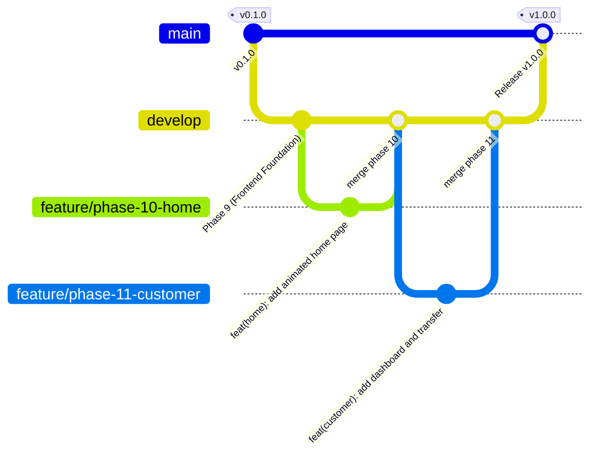

# TrustPay Guardian — Development Workflow & Engineering Standards

**Document Version:** 1.0.0  
**Target Audience:** Core Contributors, Code Reviewers, and Interview Evaluators  
**Last Updated:** 2026-10-26  

---

## 1. Prerequisites & Required Toolchain

To maintain strict parity across developer environments and CI runners, install the following pinned tool versions:

| Tool | Required Version | Verification Command | Purpose |
|---|---|---|---|
| **Java JDK** | `25.0.1+` (Temurin / OpenJDK) | `java -version` | Primary backend language runtime |
| **Apache Maven** | `3.9.6+` (or included `./mvnw`) | `./mvnw -version` | Backend dependency & lifecycle build tool |
| **Node.js** | `v24.15.0+` (LTS) | `node -v` | Frontend build and tooling runtime |
| **npm** | `11.12.0+` | `npm -v` | Frontend package manager |
| **MySQL Server** | `9.7.0 LTS` or `8.4.11 LTS` | `mysql --version` | Primary relational database engine |
| **Docker Engine** | `26.0+` & Compose `v2.27+` | `docker compose version` | Containerization and orchestration |

---

## 2. Git Branching Strategy & Release Lifecycle

TrustPay Guardian follows a disciplined Gitflow-inspired branching model designed for zero-defect integration:



### Branch Naming Rules
1. `main`: Production-ready releases only. Every commit on `main` is tagged with a semantic version (`v1.0.0`).
2. `develop`: Primary integration branch. All completed features are merged here with `--no-ff`.
3. `feature/phase-XX-description`: Dedicated feature branches branched from `develop` and merged back with non-fast-forward merges.
4. `fix/issue-description`: Hotfix or bugfix branches.

### Conventional Commit Conventions
Commit messages must strictly follow the Conventional Commits specification:
- `feat(scope): ...` — New functional capability
- `fix(scope): ...` — Bug fix or error resolution
- `test(scope): ...` — Adding or refactoring test suites
- `ci: ...` — CI/CD pipeline or Docker build configuration
- `docs: ...` — Architectural documentation updates
- `chore(release): ...` — Version tagging and dependency bumps

---

## 3. Database Migration Workflow (Flyway)

All schema mutations are managed exclusively via forward-only Flyway migrations under `backend/src/main/resources/db/migration/`.

### Migration File Naming Convention
`V<Version>__<Description>.sql` (e.g., `V1__create_users_and_accounts.sql`, `V7__add_indexes.sql`).

### Strict Rules for Writing Migrations:
1. **Never Modify Existing Applied Migrations:** Modifying an applied migration causes a Flyway Checksum Mismatch failure upon application startup.
2. **Explicit Data Types:** Use explicit storage definitions:
   - Currency: `DECIMAL(19,2) NOT NULL`
   - Timestamps: `TIMESTAMP(6) NOT NULL DEFAULT CURRENT_TIMESTAMP(6)`
   - Strings: `VARCHAR(n)` with reasonable boundaries (e.g., `VARCHAR(255)`)
3. **Explicit Constraints:** Always name constraints explicitly (e.g., `CONSTRAINT chk_accounts_balance_non_negative CHECK (balance >= 0)`).
4. **Non-Transactional DDL Recovery:** MySQL executes DDL commands immediately without rollback support. If a migration fails mid-script:
   - Identify the failed statement.
   - Drop newly created artifacts manually.
   - Run `DELETE FROM flyway_schema_history WHERE success = 0;`.
   - Re-run `./mvnw spring-boot:run`.

---

## 4. Local Development Execution Guide

### Starting the Database & Infrastructure
```bash
# Launch MySQL 9.7 and MailHog containers in background
./scripts/start-dev.sh
# Windows PowerShell: .\scripts\start-dev.ps1
```

### Running Backend API (Spring Boot)
```bash
cd backend
./mvnw spring-boot:run -Dspring-boot.run.profiles=dev
# Windows PowerShell: .\mvnw.cmd spring-boot:run -Dspring-boot.run.profiles=dev
```
- API Base URL: `http://localhost:8080/api/v1`
- Swagger OpenAPI: `http://localhost:8080/swagger-ui.html`
- Actuator Health: `http://localhost:8080/actuator/health`

### Running Frontend Application (React + Vite)
```bash
cd frontend
npm install
npm run dev
```
- Web Application: `http://localhost:5173`

---

## 5. Quality Verification Commands

Before creating a pull request or merging a feature branch, run the local verification suite:

```bash
# 1. Backend tests and JaCoCo line coverage gate (>= 80%)
cd backend
./mvnw clean verify

# 2. Frontend lint and typecheck
cd ../frontend
npm run lint

# 3. Frontend unit and component tests
npm test -- --run

# 4. Frontend production distribution build
npm run build
```
Every command must return exit code `0` with zero errors.
