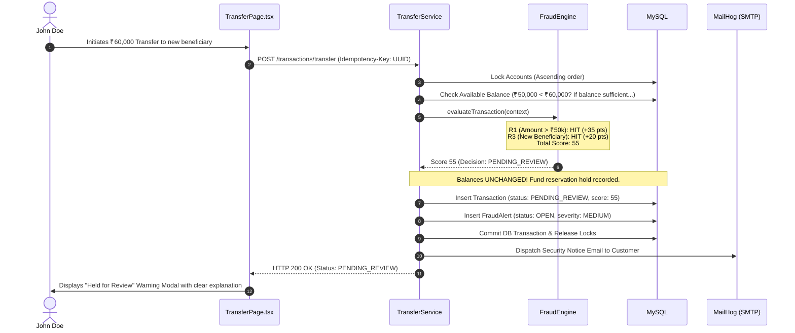
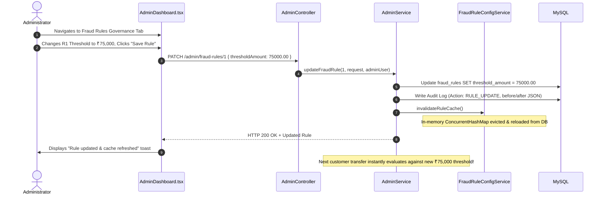

# TrustPay Guardian — Frontend-to-Backend End-to-End Execution Flows

**Document Version:** 1.0.0  
**Target Architecture:** React 19 Frontend + Spring Boot 4.1.1 API + MySQL 9.7 LTS  
**Classification:** Sequence Traces & Integration Architecture  
**Last Updated:** 2026-10-26  

---

## 1. Flow 1: Low-Risk Transfer (Instant Approval)

**Scenario:** Customer John Doe transfers ₹500.00 to saved beneficiary Jane Smith.

```mermaid
sequenceDiagram
    autonumber
    actor Customer as John Doe (Browser)
    participant UI as TransferPage.tsx
    participant Axios as axiosClient.ts
    participant Gateway as Nginx Reverse Proxy
    participant Ctrl as TransactionController
    participant Service as TransferService
    participant Engine as FraudEngine
    participant DB as MySQL (InnoDB)

    Customer->>UI: Selects Account, Jane Smith, enters ₹500, clicks Review
    UI->>Customer: Displays Review Modal with fee (₹0) and details
    Customer->>UI: Clicks "Confirm & Send Transfer"
    Note over UI: Submit button disabled; Generates UUID idempotency key

    UI->>Axios: POST /transactions/transfer (Idempotency-Key: UUID)
    Axios->>Gateway: POST /api/v1/transactions/transfer (Bearer JWT)
    Gateway->>Ctrl: Proxies request
    Ctrl->>Service: executeTransfer(request, idempotencyKey, currentUser)

    Service->>DB: Check idempotency key (None found)
    Service->>DB: Lock Account #1 & Account #2 (Ascending ID order)
    Service->>DB: Check Available Balance (₹50,000 >= ₹500: PASS)

    Service->>Engine: evaluateTransaction(context)
    Note over Engine: Rules R1-R7 evaluate. Total Score: 0 (Low Risk)
    Engine-->>Service: Score 0 (Decision: APPROVED_SIMULATED)

    Service->>DB: Debit John (₹50,000 -> ₹49,500), Credit Jane (₹30,000 -> ₹30,500)
    Service->>DB: Insert Transaction (status: APPROVED_SIMULATED)
    Service->>DB: Commit DB Transaction & Release Row Locks

    Service-->>Ctrl: TransactionResponse (TXN-..., APPROVED_SIMULATED)
    Ctrl-->>Gateway: HTTP 200 OK
    Gateway-->>Axios: HTTP 200 OK
    Axios-->>UI: Transaction Details
    UI->>Customer: Renders Success Result Modal (Green checkmark, Reference TXN-...)
```

---

## 2. Flow 2: High-Risk Transfer (Fraud Detection & Hold Reservation)

**Scenario:** Customer transfers ₹60,000 to a newly added recipient. Triggers R1 (+35 pts) and R3 (+20 pts). Total Score: 55 (Medium/High Risk).



---

## 3. Flow 3: Analyst Investigation & Decision Release

**Scenario:** Fraud Analyst Alex Vance reviews the held transfer and approves fund release.

```mermaid
sequenceDiagram
    autonumber
    actor Analyst as Fraud Analyst (Browser)
    participant UI as AnalystDashboard.tsx
    participant Ctrl as FraudAnalystController
    participant Service as FraudAnalystService
    participant DB as MySQL
    actor Customer as Customer

    Analyst->>UI: Opens Triage Queue (sorted by severity & age)
    UI->>Ctrl: GET /fraud/alerts
    Ctrl-->>UI: Alert List
    Analyst->>UI: Clicks alert row to inspect forensics
    UI->>Customer: Displays Visual Gauge (Score 55) & Rule Hits (R1, R3)

    Analyst->>UI: Enters investigation notes: "Customer verified via phone callback"
    Analyst->>UI: Clicks "Release Transfer" -> Confirms in Modal

    UI->>Ctrl: POST /fraud/alerts/{id}/release (notes: "...")
    Ctrl->>Service: releaseHeldTransfer(alertId, notes, analystUser)

    Service->>DB: Lock Source & Destination Accounts
    Service->>DB: Re-verify Account status is ACTIVE and balance sufficient
    Service->>DB: Convert Hold to permanent Ledger Debit (-₹60,000) & Credit (+₹60,000)
    Service->>DB: Update Transaction status -> APPROVED_SIMULATED
    Service->>DB: Update Alert status -> RESOLVED_RELEASED
    Service->>DB: Write Append-Only Audit Log (Action: FRAUD_ALERT_RELEASE)
    Service->>DB: Insert Notification for Customer: "Funds Released"
    Service->>DB: Commit DB Transaction

    Service-->>UI: HTTP 200 OK
    UI->>Analyst: Toast: "Transfer released successfully"
    Note over Customer: Redux 30s polling fetches notification; bell badge updates!
```

---

## 4. Flow 4: Administrator Fraud Rule Tuning & Dynamic Cache Eviction

**Scenario:** Administrator tunes Rule R1 threshold from ₹50,000 to ₹75,000.


