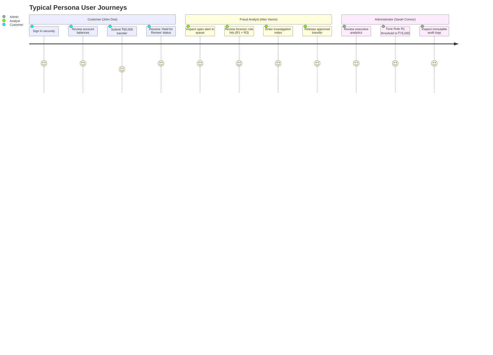

# TrustPay Guardian — Project Overview & Platform Vision

**Project Title:** TrustPay Guardian: Fraud-Aware Digital Banking Platform  
**Document Version:** 1.0.0  
**Target Release:** `v1.0.0` (Production-Grade Reference Architecture)  
**Author:** Principal Java Full Stack Engineer  
**Last Updated:** 2026-10-26  

---

## 1. Executive Summary & Purpose

**TrustPay Guardian** is an educational, portfolio-grade digital banking and fraud management platform engineered to production standards. It demonstrates how modern enterprise financial systems implement atomic money transfers, protect customer assets against sophisticated fraud vectors, enforce explainable heuristic risk scoring, and provide transparent regulatory and investigative audit trails.

> [!IMPORTANT]
> **Educational Simulation & Regulatory Disclaimer:**  
> TrustPay Guardian is designed exclusively as an educational reference architecture and portfolio simulation. It is **NOT** a licensed bank, deposit-taking institution, payment processor, or certified clearing house. It does not connect to the Reserve Bank of India (RBI), National Payments Corporation of India (NPCI / UPI), SWIFT, or real card networks. All currency figures, account numbers, and transaction flows are simulated using synthetic data.

---

## 2. Core Architectural Pillars

TrustPay Guardian is built upon four unyielding engineering pillars:

### 1. Absolute Financial Consistency (ACID & Invariants)
- **Zero Floating-Point Drift:** All money is modeled strictly as `BigDecimal` in Java with exact scale representation and `DECIMAL(19,2)` in MySQL. Floating-point arithmetic (`float`, `double`) is strictly banned.
- **Deadlock-Free Pessimistic Row Locking:** Multi-account money transfers sort source and destination account IDs in deterministic ascending order before issuing `SELECT ... FOR UPDATE`, guaranteeing that concurrent bidirectional transfers between parties can never deadlock.
- **Dynamic Available Balance Calculation:** Rather than prematurely debiting funds or allowing double-spending while an alert is pending review, available balance is calculated dynamically:
  $$\text{Available Balance} = \text{Balance} - \sum_{\text{PENDING\_REVIEW}} \text{Amount}$$
- **Engine-Level Constraints:** Invariant database CHECK constraints reject negative balances, non-positive transfer amounts, identical source/destination accounts, and risk scores outside 0–100.

### 2. 100% Deterministic & Explainable Fraud Detection
Unlike opaque machine learning "black boxes" that cannot be reasoned about in regulatory audits, TrustPay Guardian implements an explainable Strategy Pattern engine:
- **7 Independent Heuristic Rules (`R1` through `R7`):** Evaluating high transfer amounts, rapid transfer velocity, unverified beneficiaries, dormant account awakening, rapid balance depletion, round-figure anomalies, and recent brute-force login attempts.
- **Auditable Score Breakdown:** Every alert records the exact rules triggered, the points assigned, and the parameter thresholds evaluated at runtime.
- **Administrative Dynamic Tuning:** Risk points and parameter thresholds can be tuned in real-time by administrators without redeploying code.

### 3. Rigorous Role-Based Segregation of Duties (RBAC)
- **`CUSTOMER` Persona:** Manages own accounts, executes transfers, adds beneficiaries, and inspects statements with complete tenant isolation (IDOR protection returning HTTP 404).
- **`FRAUD_ANALYST` Persona:** Operates the triage queue, inspects forensic dossiers, and executes `RELEASE` or `CONFIRM_BLOCK` decisions with mandatory rationale notes.
- **`ADMIN` Persona:** Governs bank-wide accounts (freeze/unfreeze), oversees user lifecycle, tunes fraud rule weights, edits system settings, and inspects audit logs. Administrators have **read-only** visibility into fraud queues and are strictly forbidden from overriding analyst case decisions.

### 4. Zero-Trust Client Token Security
- **In-Memory JWT Access Tokens:** Access tokens reside exclusively in volatile JavaScript runtime memory (`axiosClient.ts`). Zero tokens are stored in `localStorage` or `sessionStorage`, completely closing Cross-Site Scripting (XSS) token exfiltration vectors.
- **Silent HttpOnly Cookie Refresh:** 7-day refresh tokens are transmitted solely via `HttpOnly`, `SameSite=Strict` cookies with automatic SHA-256 rotation and reuse-theft detection.

---

## 3. Supported User Personas & Workflows

---

## 4. Key Performance & Quality Indicators

- **Backend Line Coverage:** 80.5% (JaCoCo enforced quality gate >= 80%).
- **Total Test Suite:** 252 backend tests + 27 frontend tests = 279 automated tests passing with 0 failures.
- **API Endpoints:** 35 production REST endpoints with full OpenAPI 3.0 documentation.
- **Static Analysis:** Zero TypeScript errors (`tsc -b --noEmit`) and clean production bundling under Vite 6.
- **Container Readiness:** Multi-stage Dockerfiles for both services running as non-root users with active health checks.
